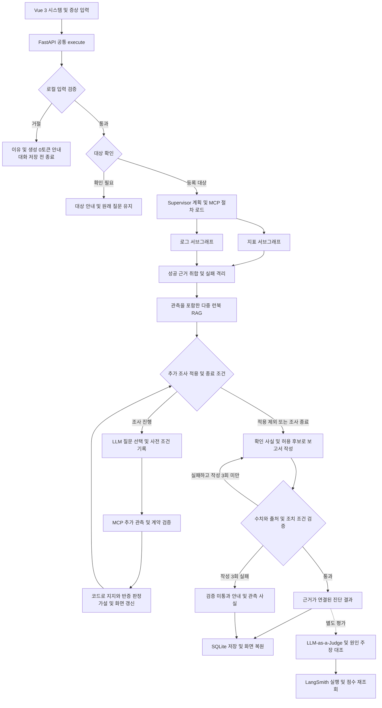
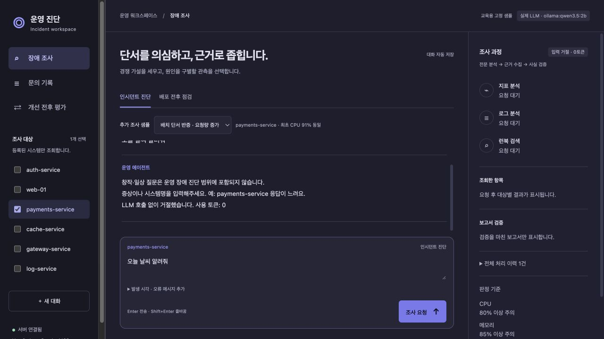
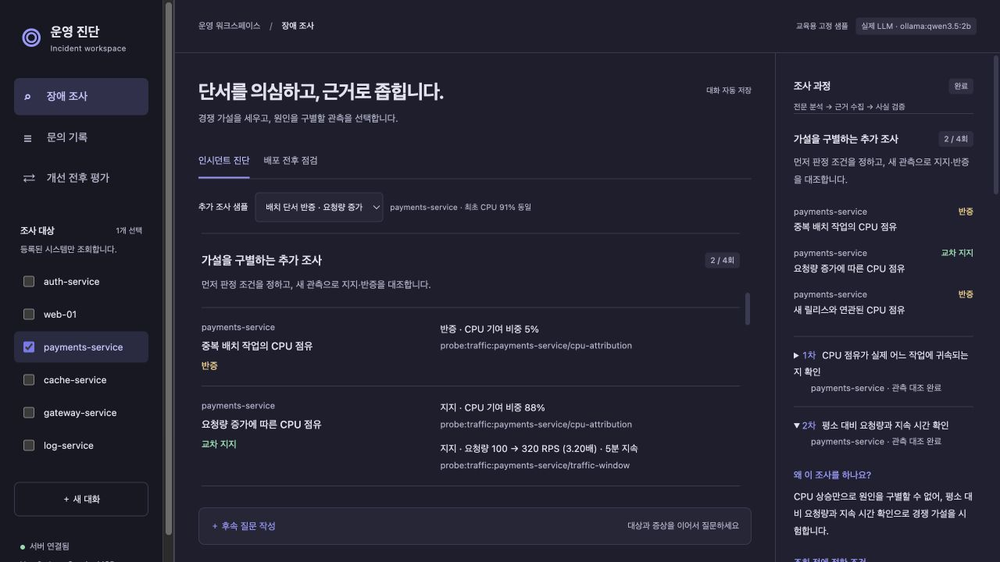

# 가설 기반 운영 진단 에이전트

## 1) 표지 및 소속 정보

| 항목 | 내용 |
| --- | --- |
| 프로젝트명 | 가설 기반 운영 진단 에이전트 |
| 소속 | SKALA 광주 2반 |
| 고유번호 | G066 |
| 이름 | 정준용 |

시스템의 장애 증상을 입력하면 지표·로그·운영 매뉴얼을 조회하고, 추가 관측으로 원인 가설을 비교하는 운영 진단 서비스다. 헬프데스크 장애 조사와 배포 전후 점검을 지원하며, 확인된 사실·원인 추정·권장 조치를 근거와 함께 제공한다.

**핵심 개선 방향:** 불필요한 입력은 모델 호출 전에 차단하고, 유효한 장애 질문은 사전에 정한 지지·반증 조건으로 조사한다.

실제 LLM과 MCP 도구를 연결해 동작하며, 지표·로그·배포 스냅샷·추가 관측은 교육용 합성 데이터다. 아래 검증 결과는 보존된 실행 기록을 기준으로 하며 실제 운영 장애의 진단 정확도를 뜻하지 않는다.

## 2) 문제 개선 및 신규 구현 사항

### 2.1 기존 시스템의 문제점 및 해결 과제

| 문제점 및 해결 과제 | 개선한 이유 | 구현 내용 |
| --- | --- | --- |
| 무의미하거나 업무와 무관한 입력도 생성 경로에 진입 | 조사할 내용이 없는 요청에 모델과 도구를 호출하면 토큰과 시간이 낭비된다. | 그래프 실행 전에 로컬 입력 validation을 적용하고 거절 문장을 대화·요약에서도 제외한다. |
| 조사 대상이 불명확하거나 여러 대상이 섞임 | 임의의 기본 시스템으로 대체하거나 대상을 누락하면 다른 시스템의 상태로 답할 수 있다. | 등록 목록을 기준으로 대상을 확인하고, 모호한 요청은 되묻고 미등록 대상은 안내한다. |
| CPU 상승과 경고 로그를 바로 원인으로 연결 | 같은 경고가 있어도 실제 CPU를 사용하는 작업은 다를 수 있다. | 배치·요청량·릴리스의 경쟁 가설을 비교하고 추가 관측으로 지지·반증을 검사한다. |
| 조회한 결과에 맞춰 판단 조건을 조정할 가능성 | 사후 설명만으로는 판단의 일관성을 확인하기 어렵다. | 지지·반증 조건을 조회 전에 기록하고 동일한 시간 구간의 관측과 대조한다. |
| 키워드 중심 문서 선택과 제한적인 근거 활용 | 복합 증상이나 우회 표현에는 여러 관련 매뉴얼이 필요하다. | 증상과 관측 내용을 반영한 임베딩 기반 다중 런북 검색을 적용한다. |
| 일부 조회 실패 또는 잘못된 초안 | 성공한 근거를 보존하면서 수치 오류와 무근거 조치를 막아야 한다. | 실패 격리·일시 오류 재시도·사실 검증을 적용하고, 작성 실패가 반복되면 관측 사실만 제공한다. |
| 중복 조사와 반복 생성 | 반복 횟수에 상한이 없으면 비용과 종료 시점이 불명확해진다. | 추가 조회 최대 4회, 동일 질문 중복 차단, 성공 근거 재사용, 작성 최대 3회를 적용한다. |
| 결과만 표시해 판단 변경 이유를 알기 어려움 | 사용자가 조사 과정과 판단 한계를 확인할 수 있어야 한다. | 가설 현황판에 조사 이유·사전 조건·관측·판단 전후·종료 이유를 표시한다. |

### 2.2 프로젝트를 통해 구현·개선한 핵심 기능

- **입력 validation과 호출 비용 통제:** 자음·기호·반복 입력과 명백한 업무 외 요청을 LLM 없이 거절한다. 화면에 이유와 생성 0토큰을 표시하고, 입력을 수정할 수 있게 남긴다. 시스템명과 맥락이 있는 짧은 후속 답변은 허용한다.
- **가설 기반 추가 조사:** 실제 LLM이 허용된 미수행 질문을 선택하고 코드가 관측을 판정한다. 단서 지지·교차 지지·반증·상충·판단 보류를 구분하며, 근거가 부족하면 원인별 CPU 조치를 보류한다.
- **근거가 연결된 진단:** 지표·로그·런북의 출처를 연결하고 확인된 사실, 원인 추정, 조건부 권장 조치를 구분한다. 수치·출처·조치 조건 검증에 실패하면 재작성하거나 관측 사실만 안내한다.
- **시스템별 조사와 부분 실패 대응:** 여러 대상을 조사하면서 실패 항목을 격리하고 성공한 결과는 유지한다. 실패 대상과 진단 한계를 명시하고 재조회할 수 있다.
- **배포 전후 점검:** CPU·메모리 사용률의 차이와 새 알림을 계산해 정상·주의·정보 부족으로 표시한다.
- **문의 기록과 맥락 복원:** 질문·대상·근거·가설 원장·판정·토큰 사용량을 SQLite에 저장한다. 새로고침 후 완료 결과를 복원하고 과거 조사에 후속 질문을 연결한다.
- **처리 과정과 평가 화면:** 전문 조회 상태, 참고 매뉴얼, 검증 결과, 추가 조사 과정을 표시한다. 별도 Judge 점수와 LangSmith 실행 근거도 확인한다.

이번 구현의 특징은 **호출 전 입력 수용 여부 → 조회 전 판정 조건 → 추가 관측 → 가설 수정**을 하나의 실행 흐름으로 연결한 점이다. RAG 검색이나 도구 호출의 성공 여부에 더해, 왜 결론이 달라졌는지를 관측 근거로 확인할 수 있게 했다.

## 3) 적용 기술 요소

### 3.1 Multi-Agent & LangGraph

[agent/graph.py](agent/graph.py#L174)가 Supervisor 역할로 대상 확인·전문 조회·추가 조사·작성·검증을 조정한다. [agent/specialists.py](agent/specialists.py)의 지표·로그·런북 전문 서브그래프는 각각 수집과 검색 책임을 담당한다.

지표와 로그를 병렬 조회한 뒤, 실제 관측 내용을 포함해 런북을 검색한다. 결과는 공통 근거 형식으로 취합하고 일부 실패를 항목별로 유지한다. LLM은 추가 질문 선택과 보고서 작성에 사용한다.

추가 조사는 `investigate_plan → investigate_probe → investigate_test`를 반복한다. 새 관측과 남은 조사 후보에 따라 다음 질문을 선택하며, 충분한 구별 근거·자료 소진·조회 한도·계획 실패 등의 조건으로 종료한다. 임의의 도구나 가설을 생성하는 대신 허용된 범위에서 재계획한다.

| 추가 관측 | 조회 전에 정한 지지·반증 기준 |
| --- | --- |
| 중복 작업 시간 구간 | 동일 실행키 중복 활성 작업 1개 이상, 중첩 3분 이상이면 배치 가설 지지. |
| 요청량 시간 구간 | 기준 대비 요청량 2배 이상이 3분 이상 지속되면 요청량 가설 지지. |
| 릴리스 및 오류율 | 새 릴리스가 있고 오류율이 기준의 3배 이상이면 릴리스 가설 지지. |
| CPU 작업군 기여 | 해당 작업군 비중 70% 이상은 지지, 15% 이하는 반증, 그 사이는 판단 보류. |

관측은 최초 지표 측정 시각으로 끝나는 동일한 5분 구간을 사용한다. 대상·질문·관측 형식·수치 범위와 배타적인 CPU 기여 비중의 합을 검증한다. 한 가설이 두 종류 관측으로 지지되고 경쟁 가설이 반증되면 조기 종료하며 전체 추가 조회는 최대 4회다.

### 3.2 MCP: Tool·Resource·Prompt 표준 인터페이스

[mcp_server.py](mcp_server.py)는 stdio MCP로 다음 기능을 제공한다.

| 인터페이스 | 구현 및 역할 |
| --- | --- |
| Tool | `list_systems`, `get_monitoring_status`, `get_recent_logs`, `get_deployment_snapshot`, `get_diagnostic_evidence`로 대상·지표·로그·전후 스냅샷·추가 관측 조회. |
| Resource | `runbook://incident-response/{incident_type}` 형식으로 등록된 런북 원문 제공. |
| Prompt | `incident_analysis_prompt`로 확정된 대상과 증상을 포함하는 공통 조사 절차 제공. |

클라이언트는 Prompt와 Resource를 탐색해 사용하고 도구 결과를 공통 계약으로 받는다. 등록 대상과 문서 ID를 확인하며 모든 도구는 읽기 전용이다. 실제 재시작·배포·설정 변경은 실행하지 않는다.

### 3.3 RAG: 벡터 기반 의미 검색 및 문서 주입

[agent/retrieval.py](agent/retrieval.py)는 매뉴얼 6종을 FastEmbed 다국어 모델로 임베딩한다. 문서 본문·해시·벡터는 SQLite 영속 인덱스에 저장하고, NumPy 코사인 유사도로 검색한다.

사용자 증상에 지표·알림 관측을 더해 질의를 만들고, 유사도 0.18 이상인 문서를 최대 3개 선택한다. 선택한 문서는 MCP Resource 원문과 대조한 뒤 보고서 근거에 주입하며 문서 ID·출처·검색 점수를 함께 제공한다. 문서 변경 시에는 해시를 기준으로 인덱스를 갱신한다.

벡터 저장과 검색은 SQLite와 NumPy로 구현했다. 관련 문서가 없거나 원문이 일치하지 않으면 정보 부족 또는 조회 실패로 처리해 근거 없는 문서 인용을 방지한다.

### 3.4 아키텍처 및 코드 품질

모델·MCP·검색기·세션 저장소·설정을 [SupervisorDeps](agent/deps.py)에 주입해 그래프와 외부 연결을 분리했다. Pydantic 계약으로 요청과 관측을 검증하고 조회·검색·판정·작성·저장 책임을 모듈별로 나눴다.

| 주요 코드 | 역할 |
| --- | --- |
| [server.py](server.py#L217), [input_validation.py](agent/input_validation.py#L19), [targets.py](agent/targets.py) | 공통 입력 검사·조기 반환·대상 및 후속 질문 확인. |
| [graph.py](agent/graph.py#L174), [specialists.py](agent/specialists.py) | Supervisor 흐름, 전문 서브그래프와 병렬 수집. |
| [investigation.py](agent/investigation.py#L25), [contracts.py](agent/contracts.py) | 사전 판정 조건, 관측 계약과 가설 상태 갱신. |
| [reporting.py](agent/reporting.py), [validation.py](agent/validation.py#L25) | 근거 기반 보고서 작성과 수치·출처·조치 조건 검사. |
| [session_store.py](agent/session_store.py), [comparison.py](agent/comparison.py) | 기록 저장·복원과 배포 전후 수치 비교. |
| [tests/](tests/), [evaluation/](evaluation/) | 입력·분기·계약·API 회귀 검사와 실제 모델 평가. |

단위·API 테스트는 결정론적 대역으로 분기와 오류 처리를 검사하고 실제 모델 평가는 별도 스크립트로 분리했다. 보존된 테스트 기록은 99개 통과다. 중복 모델 어댑터와 실행 경로를 정리했으며 비교에 필요한 기존 코드와 fake 회귀 모드는 유지한다.

### 3.5 관측 가능성 및 평가: LangSmith·LLM-as-a-Judge

[agent/observability.py](agent/observability.py)는 계획·도구 조회·검색·가설 판정·작성·평가를 LangSmith에 추적한다. 모델 입력·출력 토큰과 사용량을 기록하고, 원격 실행과 평가 점수를 다시 조회해 저장 여부를 확인한다.

[agent/judge.py](agent/judge.py#L85)는 별도 실제 LLM으로 다음 항목을 평가한다.

- 근거 충실성: 답변이 제공된 관측과 문서에 연결되는가.
- 수치 정확성: 답변의 수치가 조회값과 일치하는가.
- 조치 조건: 근거와 사전 조건에 맞는 조치인가.
- 요청 충족: 원래 질문과 조사 대상을 충족하는가.
- 다음 행동: 정보 부족과 추가 확인에 맞는 안내인가.

전체 답변 평가와 최종 원인 주장 대조를 분리한다. LLM이 관측과의 모순을 감지하면 공개된 기준으로 근거 점수에 2점 상한을 적용하되 `overall_scores`에 원래 점수를 보존한다. 매 채팅의 출력 통과 여부와 가설 판정은 코드가 담당하고 Judge는 별도 품질 평가로 사용한다.

### 3.6 기타 적용 기술

| 기술 | 적용 내용 |
| --- | --- |
| 로컬 입력 validation | 유니코드 정규화·반복 문자·운영 어휘·후속 답변 규칙을 검사한다. 거절 시 그래프·MCP·RAG·생성 호출과 대화 저장 전에 반환한다. |
| 실제 모델 연결 | OpenAI·Ollama 비동기 어댑터를 통합하고 역할별 모델을 설정한다. 보존된 실측은 계획·작성에 `qwen3.5:2b`, Judge에 `qwen3:8b`를 사용했다. OpenAI는 설정으로 지원하지만 해당 실측에는 사용하지 않았다. |
| LCEL | 프롬프트 → 모델 → 파서 경로로 보고서 후보를 선택한다. 코드가 구성한 사실과 허용 조치를 사용하며 작성은 최대 3회다. |
| FastAPI·SSE | JSON과 GET·POST SSE가 같은 입력 검사와 실행 경로를 사용하고 단계별 진행 이벤트를 전달한다. |
| Vue 3 | 시스템 선택, 조사 현황, 가설 변화, 근거, 기록과 평가 화면을 제공한다. |
| SQLite | 정상 대화·조사 ID·근거·판정·사용량을 저장하고 완료 결과와 후속 질문 맥락을 복원한다. |

입력 거절은 응답에 `status=rejected`, `tokens=0`, `model_usage=[]`, `llm_called=false`를 표시한다. 거절 문장을 이후 모델 입력에도 넣지 않으며, 조사 횟수 제한·중복 질문 차단·성공 근거 재사용으로 불필요한 호출을 억제한다. 전체 서비스 비용 절감률은 별도로 측정하지 않았다.

## 4) 구현 결과

### 4.1 아키텍처 흐름도

지표·로그의 병렬 조회, 관측을 반영한 RAG, 추가 조사 반복, 제한된 재작성과 사실 안내를 구분했다. 추가 조사 대상이 아닌 진단과 배포 전후 점검은 기존 근거 검증 흐름으로 합류한다.

### 4.2 실제 검증 결과

아래는 **2026년 10월 21일 실행 기록**이다. README 개편을 위해 실제 모델 평가를 다시 실행한 결과는 아니며 각 단계의 코드와 검증 범위를 구분한다.

| 검증 | 실행 시점 및 범위 | 결과 | 근거 |
| --- | --- | --- | --- |
| 입력 validation | 20:11 KST, 실제 Ollama 연결 서버의 JSON·GET/POST SSE 요청 | 거절 5건 생성 0토큰, 원격 실행 5건의 LLM·MCP 호출 0회 | [입력 검증 원본](artifacts/input_validation_verification.json) |
| 단위·API 회귀 | 입력 검증을 포함한 테스트 실행 기록 | 99개 통과 | [테스트 결과 포함 기록](artifacts/input_validation_verification.json) |
| 가설 조사 실제 모델 평가 | 19:48 KST, 코드 정리 및 입력 검증 도입 전의 실제 계획·작성·Judge | 기능 6/6, Judge 품질 5/6, 종합 5/6 | [가설 조사 평가 원본](artifacts/investigation_evaluation.json) |
| 정리 후 통합 검증 | 19:59 KST, 실제 모델·SSE·JSON·SQLite·세션 격리·원격 추적 등 | 실제 통합 체크 7/7, 고정 응답 회귀 12/12 | [통합 검증 원본](artifacts/cleanup_verification.json) |

**입력 거절 5건**

| 입력 | 전송 방식 | 생성 토큰 |
| --- | --- | --- |
| `ㅋㅋㅋㅋ` | JSON | 0 |
| `asdf qwer` | JSON | 0 |
| `오늘 날씨 알려줘` | POST SSE | 0 |
| `payments-service CPU에 대한 시를 써줘` | POST SSE | 0 |
| `😀😀😀` | GET SSE | 0 |

응답 값과 함께 LangSmith 원격 기록에서 LLM·MCP 호출 부재를 확인했다. 거절 입력 미저장, 원래 대상 확인 질문 유지, 시스템명과 짧은 후속 답변의 정상 처리도 검사했다. 0토큰은 차단한 요청의 생성 사용량이며 전체 비용 절감률이나 하드웨어 비용을 포함한 총비용을 뜻하지 않는다.

**가설 조사 6개 사례**

최초 CPU 91%와 경고 로그를 유지하고 추가 관측을 바꿔 결과를 비교했다.

| 사례 | 추가 조회 | 관측에 따른 결과 | Judge 근거 점수 |
| --- | --- | --- | --- |
| batch | 3회 | 중복 배치 작업의 CPU 점유 교차 지지 | 5/5 |
| traffic | 2회 | 요청량 증가에 따른 CPU 점유 교차 지지 | 5/5 |
| release | 4회 | 새 릴리스와 연관된 CPU 점유 교차 지지 | 2/5 · 검토 필요 |
| conflict | 4회 | 근거 상충으로 판단 보류 | 5/5 |
| missing | 4회 | 관측 부족으로 판단 보류 | 5/5 |
| probe-failure | 4회 | 조회 실패를 표시하고 판단 보류 | 5/5 |

release는 코드 조건을 충족한 답변에 Judge가 잘못 감점한 검토 사례로 남겼다. 기능 검사 6/6과 Judge를 함께 요구하는 종합 5/6을 구분하고 원래 실패 점수를 보존했다. 원격 실행 6건과 평가 점수 30개를 저장 후 재조회했다.

별도 대조군에서는 정상 traffic 답변에 반증된 배치를 확정 원인으로 단정하는 문장을 추가했다. 최초 전체 답변 Judge는 이를 놓쳤지만 원인 주장 대조가 모순을 감지했다. 공개 기준의 2점 상한을 적용해 근거 점수가 5→2가 됐으며 원래 전체 점수와 미탐지 기록도 남겼다. 점수 변화에는 이 코드 기준이 포함된다.

고정 응답 회귀 결과는 실제 생성 모델 간 성능 비교와 구분한다. 이전 비교 코드의 인위적 지연을 실제 LLM 속도 개선율로 사용하지 않는다.

### 4.3 주요 기능 실행 결과 화면

**입력 validation 및 생성 0토큰 안내**

시스템을 선택했더라도 업무 외 요청은 통과하지 않는다. 거절 이유와 사용 토큰을 안내하고 수정할 수 있도록 입력을 남긴다.

**추가 관측에 따른 가설 변경**

배치 CPU 기여 5%를 반증으로 기록하고, 요청 처리 기여 88%와 요청량 3.2배를 함께 확인해 요청량 가설을 교차 지지했다. 단계별 조사 이유·조회 전 조건·관측·판단 전후를 볼 수 있다. 저장된 실제 LLM 실행 화면이며 관측 데이터는 합성이다.

### 4.4 주요 기능 시연 시나리오

| 순서 | 입력 또는 조작 | 확인할 동작 |
| --- | --- | --- |
| 1 | 시스템 선택 후 `오늘 날씨 알려줘` 입력 | 로컬 거절, 사유와 생성 0토큰 표시. |
| 2 | 새 대화에서 대상 없이 `응답이 느려요` 입력 후 대상 선택 | 원래 장애 질문을 유지한 대상 확인과 후속 조사. |
| 3 | **중복 배치 경고, 정말 원인일까요?** 예시와 **배치 단서 반증 · 요청량 증가** 샘플 선택 | CPU 91% 확인 후 배치 반증과 요청량 교차 지지로 판단 변경. |
| 4 | **가설을 구별한 과정 보기** 열기 | 조사 이유, 사전 조건, 실제 관측과 상태 변경 확인. |
| 5 | **관측 근거 상충** 사례 선택 | 상충 근거를 유지하고 원인별 CPU 조치 보류. |
| 6 | 배포 전후 점검의 CPU 증가 또는 새 알림 사례 선택 | 전후 차이, 새 알림과 정상·주의·정보 부족 판정 확인. |
| 7 | 완료 후 새로고침하고 문의 기록 선택 | 완료 결과·근거·가설 이력 복원과 후속 질문 연결. |

**최신 발표 자료: 2026년 10월 22일 기술 설명 보강본**

PPT는 **8장·약 5분 30초**이다. 핵심 기능을 설명한 뒤 입력 질문·실제 답변·실행 기록으로 동작을 보여준다. 3번은 같은 최초 증상의 두 실행 답변을 비교하고, 4번은 실제 조회 순서와 종료 이유를 설명한다. 6번은 런북 검색 결과와 10월 22일 실제 Ollama 재실행의 프론트 검증 화면(작성 2회·재작성 1회·통과), 7번은 traffic·release의 개별 Judge 결과와 LangSmith 저장 확인을 보여준다. 입력 검사는 보조 기능으로 다룬다.

전체 아키텍처는 5번 한 장의 편집 가능한 8개 도형·연결선으로 유지했다. 산세리프 글꼴과 통일된 여백을 사용하고 확대·이동 효과는 사용하지 않는다. Supervisor와 전문 조회 역할, MCP 표준 인터페이스, SQLite·NumPy 기반 벡터 검색, 조회 한도의 트레이드오프를 보강했다. 발표 대본과 연결 멘트, 노트도 330초 흐름에 맞췄다.

| 요구 항목 | 발표 내용 | 슬라이드 |
| --- | --- | --- |
| 1) 표지 | 프로젝트명·소속·고유번호·이름 | 1 |
| 2) 문제 개선 및 신규 구현 | 가설 조사·근거 검증과 실제 동작 | 2~4·6 |
| 3) 적용 기술 | 전체 구조·LangGraph·MCP·RAG·LCEL·모듈화·평가 | 5~7 |
| 4) 구현 결과 | 질문·답변·조사 화면·재작성 이벤트·개별 평가 | 3~7 |
| 5) 교훈 | 한계·트레이드오프·향후 개선·수행 소감 | 8 |

- [최신 발표 PPT 다운로드](doc/presentation/운영진단_에이전트_5분발표.pptx?raw=true)
- [발표 대본·연결 멘트·화면 진행](doc/PRESENTATION_5MIN.md)
- [기능별 실행 결과와 출처](doc/presentation/EXECUTION_EXAMPLES.md)
- [실행 결과 원본 발췌 JSON](doc/presentation/assets/execution-evidence.json)
- [전체 아키텍처 PNG](doc/presentation/assets/architecture-overview.png)
- [Canva 편집본](https://www.canva.com/design/DAHYsfUQRzk/uEC9A93J8V0PhYRna1dZ4g/edit)

관측은 교육용 합성 데이터이고 계획·작성·별도 Judge는 실제 Ollama로 실행했다. 수치는 **2026년 10월 21일 보존 기록**이며 이번 발표 수정에서 모델 평가를 재실행하지 않았다. 입력 검사 도입 전 가설 조사 평가와 그 도입 후 입력 거절 검증의 범위를 구분했다. [Word 보고서 다운로드](doc/운영진단_개선결과_제출보고서.docx?raw=true)도 제공한다.

## 5) 교훈

### 5.1 한계 및 트레이드오프

| 항목 | 한계와 선택의 영향 |
| --- | --- |
| 입력 검증 | 로컬 규칙은 생성 토큰을 쓰지 않지만 정상 표현의 오탐과 우회 표현의 미탐이 생길 수 있다. |
| 조사 범위 | 현재 추가 조사는 CPU 80% 이상인 헬프데스크 인시던트의 세 가설·네 관측 종류에 적용하며 상세 관측은 `payments-service`에 제공한다. |
| 비용과 조사 깊이 | 전체 4회 한도는 호출을 제한하지만 미확인 가설을 남길 수 있다. 질문 우선순위는 휴리스틱이며 최소 호출 경로를 보장하지 않는다. |
| 관측과 인과 | 두 종류 관측의 교차 지지도 실제 원인 확정과 같지 않다. 합성 데이터 결과를 운영 장애 정확도로 일반화할 수 없다. |
| 의미 평가 | Judge도 정상 답변을 잘못 감점하거나 오류를 놓칠 수 있다. 생성기와 Judge가 같은 Qwen 계열인 상관 편향도 남는다. |
| 결과 복원 | 완료 결과와 후속 질문 맥락을 복원하며 실행 중 LangGraph 체크포인트 재개는 지원하지 않는다. |
| 비용 측정 | 거절 5건의 생성 0토큰은 검증했지만 전체 요청 대비 절감률과 하드웨어 비용은 측정하지 않았다. |

### 5.2 향후 추가 개선 사항

1. 실제 모니터링·프로파일러를 MCP에 연결하고 관측 누락·지연·수집 시점의 일관성을 검증한다.
2. 정상·비정상 입력에 사람 라벨을 붙여 필터의 오탐·미탐률을 측정하고 표현 범위를 보완한다.
3. 다른 계열 Judge와 사람 평가를 비교해 의미 평가의 신뢰도와 편향을 확인한다.
4. 동일 질문·데이터·모델 설정으로 호출 횟수·토큰·지연시간을 비교해 비용 통제 효과를 계측한다.
5. 검증된 조사 정책을 메모리·네트워크 등으로 확장하고 질문 선택 정책을 평가한다.

### 5.3 수행 소감 및 느낀 점

모델이 자연스럽게 설명한다는 사실만으로 진단을 신뢰하기는 어렵다는 점을 배웠다. 판단 조건을 먼저 고정하고 원본 관측과 연결하자 설명이 달라진 이유를 코드와 화면에서 확인할 수 있었다. 입력 거절과 결론 보류도 이유와 남은 확인 항목을 보여주는 정상적인 결과로 설계할 필요가 있었다.

또한 LLM을 호출하지 않는 입력 검증도 서비스 품질과 비용을 개선하는 중요한 기능임을 확인했다. 토큰 절감 자체뿐 아니라 정상적인 후속 질문을 보존하는 균형이 필요했다.

평가 과정에서는 Judge의 오판과 미탐지도 경험했다. 기능 검사와 의미 평가를 분리하고 실패 기록을 보존해야 개선 효과를 과장하지 않을 수 있었다. 모델에는 질문과 보고서 후보 선택을 맡기고, 대상·수치·조치 조건·종료 여부는 코드가 책임지도록 역할을 나눈 것이 핵심 설계 경험이었다.
