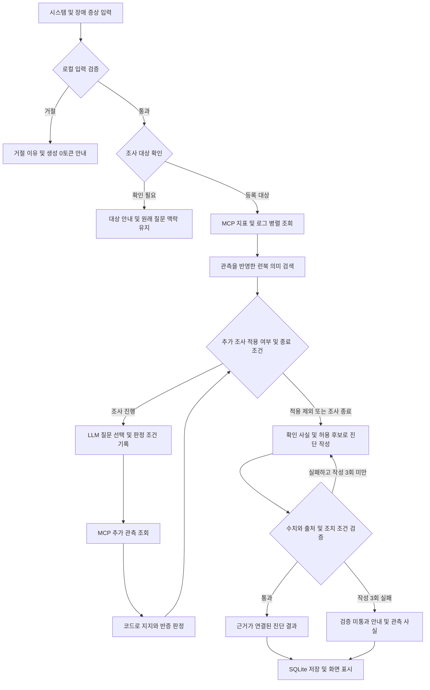

# 가설 기반 운영 진단 에이전트

시스템의 장애 증상을 입력하면 모니터링 지표·로그·운영 매뉴얼을 조회하고, 추가 관측으로 원인 가설을 비교하는 운영 진단 서비스다. 장애 조사와 배포 전후 점검을 지원하며, 확인된 사실·원인 추정·권장 조치를 근거와 함께 제공한다.

**FastAPI · LangGraph · MCP · RAG · Vue 3 · SQLite · LangSmith**

## 주요 기능

| 기능 | 설명 |
| --- | --- |
| LLM 호출 전 입력 검증 | 무의미한 문자·반복 입력·명백한 업무 외 질문을 백엔드의 로컬 규칙으로 거절하고 이유와 생성 0토큰을 표시한다. |
| 조사 대상 및 대화 맥락 확인 | 등록 시스템 목록에서 대상을 선택하고 여러 시스템을 함께 조사한다. 모호한 대상은 되묻고, 미등록 시스템은 안내하며 이전 조사에 대한 후속 질문을 연결한다. |
| 지표·로그·런북 조회 | 지표와 로그를 병렬 수집하고, 증상과 관측 내용을 반영한 의미 검색으로 관련 운영 매뉴얼을 찾는다. |
| 가설 기반 추가 조사 | 배치·요청량·릴리스 가설을 비교한다. 조회 전에 지지·반증 조건을 기록하고 새 관측에 따라 판단을 갱신한다. |
| 근거가 연결된 진단 | 시스템명·수치·근거 ID·조치 조건을 코드로 검사한다. 작성은 최대 3회로 제한하고 검증을 통과하지 못하면 확인 가능한 관측만 안내한다. |
| 부분 실패 대응 | 조회 실패와 타임아웃을 항목별로 표시하고 성공한 근거를 보존한다. 일시적 호출 오류를 재시도하고 실패 항목을 다시 조회할 수 있다. |
| 배포 전후 점검 | CPU·메모리 사용률의 차이와 새 알림을 비교해 정상·주의·정보 부족으로 표시한다. |
| 문의 기록 및 복원 | 질문·대상·근거·가설 변화·판정·토큰 사용량을 SQLite에 저장하고, 새로고침 후 완료 결과와 대화 맥락을 복원한다. |
| 과정 추적 및 품질 평가 | 조사 상태와 참고 매뉴얼을 화면에 표시하고, LangSmith 트레이싱과 별도 LLM-as-a-Judge 평가 결과를 확인한다. |

## 가설 기반 추가 조사

CPU 경고와 로그만으로 원인을 단정하지 않고, 서로 다른 설명을 구별할 관측을 선택한다. LLM은 허용된 미수행 질문을 선택하며, 가설의 상태는 코드가 관측 조건을 대조해 결정한다.

| 추가 관측 | 확인 내용 | 가설 지지 조건 |
| --- | --- | --- |
| 중복 작업 조회 | 같은 실행키를 가진 배치 작업의 활성 상태와 중첩 시간 | 중복 활성 작업 1개 이상, 중첩 3분 이상 |
| 요청량 조회 | 평소 대비 요청량과 증가 지속 시간 | 기준의 2배 이상으로 3분 이상 지속 |
| 릴리스 조회 | 새 릴리스 여부와 오류율 변화 | 새 릴리스가 있고 오류율이 기준의 3배 이상 |
| CPU 기여 조회 | 배치·요청 처리·새 릴리스 작업군의 CPU 기여 비중 | 70% 이상은 지지, 15% 이하는 반증, 그 사이는 판단 보류 |

관측은 최초 지표 측정 시각으로 끝나는 동일한 5분 구간을 사용한다. 대상·질문·관측 형식·수치 범위를 검증하고, 화면에는 **조사 이유 → 사전 조건 → 실제 관측 → 판단 변경**을 표시한다.

가설 상태는 미확인·단서 지지·교차 지지·반증·근거 상충·판단 보류로 구분한다. 한 가설이 두 종류 관측으로 지지되고 경쟁 가설이 반증되면 조기 종료하며, 전체 추가 조회는 최대 4회다. 자료가 부족하거나 상충하면 판단과 원인별 CPU 조치를 보류한다.

## 동작 흐름

JSON과 GET·POST SSE 요청은 같은 입력 검증과 실행 경로를 사용한다. 거절한 입력은 그래프·MCP·RAG를 실행하지 않고 종료하며 대화·요약에도 저장하지 않는다. 시스템명과 맥락이 있는 짧은 후속 답변은 대상 확인 및 기존 조사로 연결한다.

LLM-as-a-Judge는 별도 평가 경로에서 근거 충실성·수치 정확성·조치 조건·요청 충족·다음 행동을 평가한다. 매 요청의 최종 출력 검증과 가설 판정은 코드가 담당한다.

## 기술 구성

| 영역 | 적용 기술 및 역할 |
| --- | --- |
| 프론트엔드 | Vue 3, HTML, CSS — 장애 조사·가설 현황·문의 기록·평가 화면 |
| 백엔드 | Python, FastAPI, Pydantic — 공통 API, 입력 및 관측 계약 검증, SSE 진행 이벤트 |
| 에이전트 흐름 | LangGraph — 전문 서브그래프 실행, 추가 조사 반복, 보고서 작성 및 검증 분기 |
| 모델 연결 | 비동기 OpenAI·Ollama 어댑터 — 계획·작성·Judge 역할별 모델 설정 |
| 도구 인터페이스 | stdio MCP — 지표·로그·스냅샷·추가 관측 Tool, 런북 Resource, 조사 절차 Prompt |
| 문서 검색 | FastEmbed 다국어 임베딩, NumPy 코사인 유사도, SQLite 영속 벡터 인덱스 |
| 보고서 생성 | LCEL 프롬프트 → 모델 → 파서, 사실 및 허용 후보 기반 작성 |
| 기록 저장 | SQLite — 대화, 조사 결과, 근거, 가설 원장, 모델 사용량 |
| 추적 및 평가 | LangSmith, LLM-as-a-Judge, pytest — 실행 추적, 별도 의미 평가, 회귀 검사 |

기본 모델 설정은 계획·작성에 Ollama `qwen3.5:2b`, 별도 Judge에 `qwen3:8b`를 사용한다. OpenAI도 환경 설정으로 연결할 수 있다. 모델 연결 실패는 오류로 처리하며 실제 호출을 테스트 응답으로 대체하지 않는다.

런북 6종은 문서와 벡터를 SQLite에 보관하고 유사도가 높은 문서를 최대 3개 검색한다. 조회한 원문과 출처를 진단 근거에 연결한다.

## 주요 화면

### 장애 조사 및 가설 변화

같은 CPU 91%와 배치 경고에서 출발해도 배치의 CPU 기여가 5%이면 해당 가설을 반증할 수 있다. 위 화면은 요청 처리 기여 88%와 요청량 3.2배를 함께 확인해 요청량 가설을 교차 지지한 실행 결과다. 각 단계의 선택 이유와 근거, 판단 변경을 확인할 수 있다.

### 입력 거절 및 호출 비용 통제

무의미하거나 명백한 업무 외 입력은 모델 호출 전에 거절한다. 거절 이유를 안내하고 입력을 수정할 수 있도록 남긴다. 조사 횟수 제한·중복 질문 차단·성공 근거 재사용도 불필요한 호출을 억제한다.

## 프로젝트 구조

| 경로 | 역할 |
| --- | --- |
| [server.py](server.py) | FastAPI 진입점, 공통 입력 검사, JSON·SSE 실행 경로 |
| [agent/graph.py](agent/graph.py), [agent/specialists.py](agent/specialists.py) | 전체 흐름 조정 및 지표·로그·런북 전문 조회 |
| [agent/input_validation.py](agent/input_validation.py), [agent/targets.py](agent/targets.py) | 로컬 입력 검증과 대상·후속 질문 해석 |
| [agent/investigation.py](agent/investigation.py), [agent/contracts.py](agent/contracts.py) | 추가 조사 정책, 관측 계약과 가설 상태 갱신 |
| [agent/retrieval.py](agent/retrieval.py), [mcp_server.py](mcp_server.py) | 매뉴얼 의미 검색과 MCP 인터페이스 |
| [agent/reporting.py](agent/reporting.py), [agent/validation.py](agent/validation.py) | 근거 기반 진단 작성과 사실 검증 |
| [agent/llm_runtime.py](agent/llm_runtime.py), [agent/judge.py](agent/judge.py), [agent/observability.py](agent/observability.py) | 모델 호출, 별도 품질 평가와 트레이싱 |
| [agent/session_store.py](agent/session_store.py) | 대화와 조사 기록 저장 및 복원 |
| [frontend/](frontend/), [web_chat.html](web_chat.html), [web_demo_server.py](web_demo_server.py) | Vue 화면, 정적 파일 제공과 API 프록시 |
| [data/](data/) | 등록 시스템, 합성 지표·로그·배포 스냅샷·추가 관측과 런북 |
| [tests/](tests/), [evaluation/](evaluation/) | 단위·API·회귀 검사와 실제 모델 평가 |

## 데이터 및 적용 범위

모니터링 지표·로그·배포 스냅샷·추가 관측은 교육용 합성 데이터다. 실제 LLM과 MCP 도구를 연결해 동작하며, 모든 도구는 읽기 전용 조회를 수행한다.

가설 기반 추가 조사는 CPU 80% 이상인 헬프데스크 인시던트에 적용하며 상세 관측은 `payments-service`에 제공한다. 교차 지지는 관측 조건에 따른 판단이며 인과관계 확정을 뜻하지 않는다. 입력 검증은 로컬 규칙을 사용하므로 표현에 따라 오탐과 미탐이 생길 수 있다.
