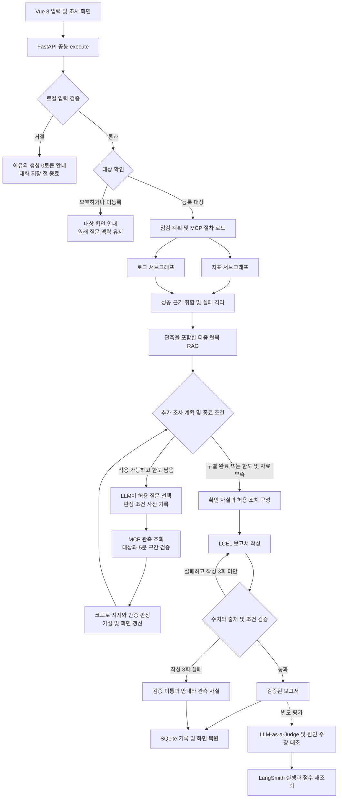

# 가설 기반 운영 진단 에이전트 — 최종 개선 보고서

**FastAPI · LangGraph · MCP · RAG · Vue 3 · SQLite · LangSmith**

최종 구현 및 입력 검증 확인: **2026년 10월 21일 20:11 KST**

불필요한 요청은 LLM 호출 전에 거절하고, 유효한 장애 질문은 **경쟁 가설을 구별하는 추가 관측**으로 조사하도록 개선했다. 최초 경고에 맞는 설명을 작성하는 데서 끝나지 않고, 그 설명이 틀릴 수 있는 조건을 먼저 기록한 뒤 관측 결과에 따라 판단을 수정한다.

최신 입력 거절 5건은 생성 **0토큰**, 현재 테스트는 **99개 통과**다. 앞서 수행한 실제 LLM 가설 조사 평가는 **기능 6/6, Judge 포함 종합 5/6**으로, 실행 시점과 평가 범위를 구분해 제시한다.

실제 계획·작성·평가 모델을 연결해 검증했다. 장애 지표·로그·추가 관측은 교육용 합성 데이터이며, 실제 운영 환경의 원인 진단 정확도를 측정한 결과는 아니다.

[보고서 보기](doc/IMPROVEMENT_REPORT.md) · [Word 다운로드](doc/운영진단_개선결과_제출보고서.docx?raw=true) · [PPT 다운로드](doc/presentation/운영진단_에이전트_5분발표.pptx?raw=true) · [발표 멘트·코드 위치](doc/PRESENTATION_5MIN.md)

Word와 PPT는 내려받아 해당 프로그램에서 연다. GitHub에서 바로 읽을 수 있는 보고서와 코드 링크도 함께 제공한다.

## 1. 프로젝트 개요

사용자가 시스템과 증상을 입력하면 모니터링·로그·런북을 조회하고, 확인한 사실과 원인 가설, 조건부 권장 조치를 구분해 제공하는 운영 진단 워크스페이스다. 헬프데스크 장애 조사와 배포 전후 점검을 지원한다.

이번 개선은 다음 두 질문에서 출발했다.

- **이 요청에 모델을 호출할 필요가 있는가?** 무의미하거나 명백한 업무 외 입력은 백엔드에서 먼저 차단한다.
- **지금 떠오른 원인이 틀렸다는 것을 무엇으로 확인할 수 있는가?** 추가 관측의 지지·반증 조건을 조회 전에 정하고, 결과에 따라 가설을 갱신한다.

## 2. 문제 개선 및 신규 구현 사항

### 2.1 기존 문제와 개선 판단

| 기존 문제 및 해결 과제 | 개선한 이유 | 최종 구현 |
| --- | --- | --- |
| 무의미한 입력도 생성 경로에 진입 | 답할 가치가 없는 요청에 모델과 도구를 호출하면 토큰과 시간이 낭비된다. | 로컬 입력 검사를 그래프 앞에 배치하고 거절 문장을 대화·요약에서도 제외한다. |
| CPU 상승과 경고 로그를 곧바로 원인으로 연결 | 같은 경고가 있어도 실제 CPU를 사용하는 작업은 다를 수 있다. | 배치·요청량·릴리스 가설을 비교하고 다음 관측을 선택한다. |
| 조회한 결과에 맞춰 판단 조건을 바꿀 가능성 | 사후 설명만으로는 결론의 일관성을 검증하기 어렵다. | 지지·반증 조건을 조회 전에 기록하고 동일한 시간 구간의 관측과 대조한다. |
| 자료를 더 모으기만 하는 반복 조사 | 중복 조회와 무제한 재계획은 비용을 늘리고 종료 시점을 불명확하게 만든다. | 추가 관측 최대 4회, 동일 질문 중복 차단, 성공 근거 재사용과 명시적 종료 이유를 적용한다. |
| 일부 조회 실패나 잘못된 초안 | 성공한 사실은 보존하면서 잘못된 수치와 무근거 조치를 막아야 한다. | 실패 격리·일시 오류 재시도와 코드 검증을 적용하고, 작성 3회 실패 시 관측 사실만 안내한다. |
| 결과만 표시해 판단이 바뀐 이유를 알기 어려움 | 사용자가 조사 과정과 판단 한계를 확인할 수 있어야 한다. | 가설 현황판에 선택 이유·사전 조건·관측·상태 변경·종료 이유를 표시한다. |
| 중복 모델 어댑터와 실행 스크립트 | 호출 경로가 여러 개면 오류 처리와 검증 기준이 달라진다. | 비동기 공통 호출 경로로 통합하고 불필요한 스크립트 8개와 코드 400여 줄을 정리했다. |

### 2.2 주요 개선 사항

- **호출 전 입력 검증:** 자음·기호·반복 입력과 명백한 업무 외 요청을 LLM 없이 거절한다. 시스템명과 맥락이 있는 짧은 후속 답변은 기존 조사로 연결한다.
- **가설을 구별하는 추가 조사:** 실제 LLM이 허용된 미수행 질문을 선택하고, 코드는 사전에 정한 조건으로 관측을 판정한다. LLM이 관측 수치나 판정 규칙을 임의로 만들 수 없도록 범위를 제한했다.
- **근거 상충과 판단 보류:** 단서 지지·교차 지지·반증·상충·정보 부족을 구분한다. 충분한 근거가 없으면 원인별 CPU 조치를 제시하지 않는다.
- **수치·출처·조치 조건 검증:** 조회값과 근거 ID를 코드로 검사하고 재작성을 제한한다. LLM-as-a-Judge는 별도 평가로 수행해 의미적 오류와 평가자의 오판도 기록한다.
- **호출 비용 통제:** 거절 입력의 생성 호출과 후속 맥락 유입을 차단하고, 조사 상한·중복 차단·성공 결과 재사용으로 불필요한 호출을 억제한다.

### 2.3 추가한 기능

- 백엔드 거절 이유와 **사용 토큰 0** 표시, 입력 수정 후 재제출.
- CPU 경쟁 가설 현황판과 단계별 추가 조사 이력.
- 조회 전 예상 조건과 실제 관측, 판단 변경 전후의 비교 표시.
- 대상·시간 구간·관측 형식·수치 범위를 검증하는 읽기 전용 MCP 추가 관측 도구.
- SQLite 기반 완료 결과·근거·가설 원장·사용량 복원과 과거 조사에 연결되는 후속 질문.
- 실제 Judge 점수, 검토 필요 사례, LangSmith 실행 근거를 확인하는 평가 화면.

### 2.4 처음 제시한 개선 예시와의 차별점

RAG 다중 검색, MCP 조회, 부분 실패 대응, SQLite 기록, 사실 검증은 처음 제시한 예시와 겹치는 공통 기반이다. 이번 구현은 **입력 수용 여부 → 반증 가능한 조사 → 판단 수정 → 검증 기록**을 연결한 부분에 차별점을 두었다.

| 비교 관점 | 이번 구현에서 구체화한 차이 |
| --- | --- |
| 추가 조사 | 자료를 한 번 더 조회하는 데서 나아가, 경쟁 가설을 구별할 질문과 지지·반증 조건을 먼저 기록한다. |
| 원인 추정 | 같은 CPU 91%와 경고에서 시작해도 CPU 기여·요청량 등 추가 관측에 따라 다른 결론이나 판단 보류로 전환한다. |
| 과정 시각화 | 도구 실행 상태에 더해 조사 이유, 사전 조건, 새 관측과 가설 상태의 변화를 연결해 보여준다. |
| 토큰 절감 | 모델로 입력을 분류하지 않고 생성 경로 진입 전에 차단한다. 거절 5건의 0토큰을 원격 호출 기록으로도 확인했다. |
| 평가 | 기능 통과와 Judge 품질 점수를 분리하고, 평가자의 오판과 최초 평가의 미탐지를 원본에 남긴다. |

## 3. 적용 기술 요소

### 3.1 아키텍처 및 실행 흐름

아래는 유효한 운영 요청의 주요 흐름이다. JSON과 GET·POST SSE는 같은 백엔드 실행 함수를 사용한다.



추가 조사에 해당하지 않는 메모리·네트워크 진단과 배포 전후 점검은 기존 근거 검증 흐름으로 이어진다. Judge는 매 채팅의 출력 통과 장치가 아니라 별도 평가 경로다.

### 3.2 백엔드 입력 validation과 토큰 절감

[server.py](server.py)의 `execute`에서 그래프 실행 전에 [validate_input](agent/input_validation.py)을 호출한다. 유니코드 정규화와 보이지 않는 문자 제거 후 로컬 규칙으로 검사한다. 시스템을 선택했더라도 잡담이 자동으로 통과하지 않는다.

```python
# server.py 핵심 흐름 발췌 — 이벤트 구성 등 일부 생략
admission = validate_input(req.message, known, state["context"], req.targets)
if not admission["passed"]:
    # InputRejected와 FinalAnswer에 거절 이유·0토큰·llm_called=False 전달
    ...
    return  # SQLite 저장과 graph.astream 이전에 종료

# 통과한 요청만 LangGraph 실행
async for mode, payload in deadline_stream(
    app.state.graph.astream(state, stream_mode=["updates", "custom"]),
    deps.settings.request_timeout,
):
    ...
```

운영 범위 밖 입력의 거절은 HTTP 200 응답의 `metadata.status="rejected"`로 표현한다. `tokens=0`, `model_usage=[]`, `llm_called=false`를 함께 반환한다. SSE는 거절 이벤트와 최종 안내 후 종료한다. 빈 입력·길이 초과 같은 요청 형식 오류는 Pydantic 검증에서 처리한다.

등록·미등록 시스템명은 대상 확인 절차로 보내고, 조사 맥락이 있는 `왜?`, `없음`, `오전 9시` 같은 짧은 답변은 허용한다. 거절 문장은 SQLite 대화·요약에 저장하지 않으며, 기존의 대상 확인 질문과 정상 조사 맥락을 유지한다.

| 비용 통제 방법 | 확인한 범위 |
| --- | --- |
| 로컬 입력 검사 후 조기 반환 | 실제 연결 서버의 거절 5건에서 생성 0토큰, LLM·MCP 호출 0회 확인. |
| 거절 입력의 대화·요약 저장 제외 | 다음 생성 요청에 거절 문장을 다시 넣지 않는 구조와 미저장 검증. |
| 관측을 포함한 RAG 1회 검색, 중복 조사 차단, 성공 결과 재사용 | 호출 억제 정책을 구현했다. 개별 정책의 토큰 감소량은 별도로 측정하지 않았다. |
| 추가 관측 최대 4회, 보고서 작성 최대 3회 | 반복 실행에 상한을 둔다. 최적 비용이나 최소 조사 경로를 보장하지 않는다. |

**0토큰은 차단한 요청의 생성 모델 입력·출력 사용량이다.** 전체 서비스의 비용 절감률이나 유료 API 달러 절감액은 산출하지 않았다. 정상 진단과 별도 Judge에는 토큰이 사용되며, 로컬 추론의 하드웨어 비용도 별도다.

### 3.3 Multi-Agent 및 LangGraph 조사 구조

[agent/graph.py](agent/graph.py)가 대상 확인·전문 조회·추가 조사·작성·검증을 조정한다. 지표와 로그 서브그래프는 병렬 실행하고, 런북 서브그래프는 수집한 관측을 반영해 검색한다. 각 단계의 완료·생략·실패 상태를 프론트에 전달한다.

[agent/investigation.py](agent/investigation.py)의 `investigate_plan → investigate_probe → investigate_test`가 반복 조사 경로다. 실제 LLM은 허용된 미수행 질문 ID와 목적을 선택한다. 세 CPU 가설과 네 관측 종류는 코드에 정의되어 있으며, 자유롭게 가설이나 도구를 생성하는 구조는 아니다.

| 관측 | 조회 전에 정한 판정 기준 |
| --- | --- |
| 중복 작업 시간 구간 | 동일 실행키 중복 활성 작업 1개 이상, 중첩 3분 이상이면 배치 가설 지지. |
| 요청량 시간 구간 | 기준 대비 요청량 2배 이상, 지속 3분 이상이면 요청량 가설 지지. |
| 릴리스 및 오류율 | 새 릴리스가 있고 오류율이 기준의 3배 이상이면 릴리스 가설 지지. |
| CPU 작업군 기여 | 해당 작업군 비중 70% 이상은 지지, 15% 이하는 반증, 그 사이는 판단 보류. |

관측의 대상·질문·데이터 사례·수치 범위와 최초 지표의 측정 시각으로 끝나는 동일한 5분 구간을 검증한다. 배타적인 CPU 작업군 비중의 합도 검사한다. 상태는 미확인·단서 지지·교차 지지·반증·상충·판단 보류로 구분한다.

한 가설이 두 종류 관측으로 지지되고 경쟁 가설이 반증되면 조기 종료한다. 자료 누락·실패·상충이나 전체 4회 한도에 도달하면 성공한 관측을 보존하고 남은 판단을 보류한다. 화면의 선택 이유는 검증 가능한 설명 템플릿이며 모델 내부 사고 과정을 노출하는 기능은 아니다.

### 3.4 MCP 표준 인터페이스와 RAG

[mcp_server.py](mcp_server.py)는 stdio MCP로 다음 인터페이스를 제공한다.

- **Tool:** 등록 시스템, 지표, 로그, 배포 전후 스냅샷과 추가 진단 관측 조회.
- **Resource:** `runbook://incident-response/{incident_type}` 형식의 런북 원문.
- **Prompt:** 대상과 증상을 받는 표준 읽기 전용 조사 절차.

추가 관측은 [agent/contracts.py](agent/contracts.py)의 형식과 판정에 필요한 값을 검증한다. 도구는 읽기 전용이며 실제 재시작·배포·설정 변경을 실행하지 않는다.

[agent/retrieval.py](agent/retrieval.py)는 Markdown 매뉴얼 6종을 FastEmbed 다국어 임베딩으로 변환한다. 문서 해시와 벡터를 SQLite에 저장하고 NumPy 코사인 유사도로 상위 3개를 검색한다. 유사도 0.18 미만은 제외하며, 선택한 문서는 MCP 원문과 대조한다. 별도 Chroma·FAISS 서버를 사용하지 않는 소규모 영속 벡터 인덱스다.

### 3.5 실제 모델 연결, 보고서 검증 및 관측 가능성

[agent/llm_runtime.py](agent/llm_runtime.py)에서 OpenAI·Ollama의 비동기 호출과 사용량 처리를 통합했다. 역할별 모델은 설정으로 분리하며, 저장된 실제 검증에서는 **계획·작성 모두 Ollama `qwen3.5:2b`**, **별도 Judge는 `qwen3:8b`**를 사용했다. OpenAI는 연결 설정을 지원하지만 이번 실측에는 사용하지 않았다. 연결 실패를 fake 성공으로 대체하지 않는다.

보고서는 LCEL의 프롬프트 → 모델 → 파서 경로로 작성한다. 작성 모델은 코드가 구성한 사실과 허용 후보를 선택하며, [agent/validation.py](agent/validation.py)가 시스템명·수치·상태·근거 ID·조치 조건·필수 항목을 검사한다. 최대 3회 작성 후에도 실패하면 검증 미통과를 알리고 관측 사실만 제공한다.

[agent/judge.py](agent/judge.py)는 근거 충실성·수치 정확성·조치 조건·요청 충족·다음 행동을 별도로 평가한다. 전체 답변 평가에 더해 최종 원인 주장과 관측의 모순을 실제 LLM으로 대조한다. 모순을 감지하면 공개된 기준으로 근거 점수에 2점 상한을 적용하되 `overall_scores`에 원래 점수를 보존한다.

[agent/observability.py](agent/observability.py)는 LangSmith 실행과 LLM·MCP·검색·판정·평가 단계를 추적한다. 저장 요청의 성공만 확인하지 않고 **원격 실행과 평가 점수를 다시 조회**해 기록 존재를 검증했다.

### 3.6 프론트엔드, 기록 및 코드 품질

Vue 3 화면은 시스템 선택, 조사 진행, 참고 매뉴얼, 가설별 근거와 판단 변화를 표시한다. 입력 거절 이유와 0토큰도 표시하며 사용자가 입력을 수정할 수 있게 남긴다. 데스크톱·모바일 레이아웃을 지원한다.

SQLite에는 정상 질문·대상·메시지별 조사 ID·근거·가설 원장·판정·사용량을 저장한다. 새로고침 후 완료 결과를 복원하고 선택한 과거 조사의 후속 질문을 해당 대상에 연결한다. 실행 중 LangGraph의 체크포인트 재개는 구현하지 않았다.

조회·검색·모델·판정·보고·저장 모듈을 분리하고 의존성을 주입한다. pytest는 실제 생성 호출 없이 규칙·분기·계약·API 회귀를 검사하고, 실제 모델 평가는 별도 스크립트로 실행한다. 중복 실행 경로를 정리했으며 고정 회귀 비교에 필요한 기존 버전과 fake 모델은 유지했다.

## 4. 구현 결과

### 4.1 최신 입력 validation 및 0토큰 검증

**실측 시각: 2026년 10월 21일 20:11 KST.** 실제 Ollama가 연결된 서버의 프론트 프록시를 통해 다음 요청을 보냈다.

| 입력 | 전송 방식 | 결과 | 생성 토큰 |
| --- | --- | --- | --- |
| `ㅋㅋㅋㅋ` | JSON | 내용 부족 거절 | 0 |
| `asdf qwer` | JSON | 운영 범위 외 거절 | 0 |
| `오늘 날씨 알려줘` | POST SSE | 운영 범위 외 거절 | 0 |
| `payments-service CPU에 대한 시를 써줘` | POST SSE | 창작 요청 거절 | 0 |
| `😀😀😀` | GET SSE | 내용 부족 거절 | 0 |

응답의 0토큰 값과 함께 LangSmith 원격 실행 5건에서 **LLM span 0개·MCP span 0개**를 확인했다. 거절 입력 미저장과 원래 대상 확인 질문의 보존도 검사했다. 단위·API 테스트에서는 실행되면 실패하는 대역으로 그래프 미진입을 확인하고, 시스템명과 짧은 후속 답변의 정상 처리도 검증했다.


검증 원본: [input_validation_verification.json](artifacts/input_validation_verification.json). 현재 소스 지문과 테스트 **99개 통과** 결과를 포함한다.

### 4.2 가설 조사 실제 LLM 평가

**실행 기록: 2026년 10월 21일 19:48 KST.** 최초 CPU 91%와 경고 로그를 동일하게 두고 추가 관측을 바꾼 여섯 사례에서 실제 계획·작성·Judge를 실행했다. 아래는 **입력 검증 도입 및 코드 정리 전 평가 원본**이다. 이후 변경까지 포함해 여섯 건을 다시 실측한 결과로 제시하지 않는다.

| 사례 | 추가 관측 조회 | 관측에 따른 결과 | Judge 근거 점수 |
| --- | --- | --- | --- |
| batch | 3회 | 중복 배치 작업의 CPU 점유 교차 지지 | 5/5 |
| traffic | 2회 | 요청량 증가에 따른 CPU 점유 교차 지지 | 5/5 |
| release | 4회 | 새 릴리스와 연관된 CPU 점유 교차 지지 | 2/5 · 검토 필요 |
| conflict | 4회 | 근거 상충으로 판단 보류 | 5/5 |
| missing | 4회 | 추가 관측 부족으로 판단 보류 | 5/5 |
| probe-failure | 4회 | 일부 조회 실패를 표시하고 판단 보류 | 5/5 |

기능 검사는 **6/6**, Judge 품질 기준은 **5/6**, 두 기준을 함께 요구하는 원래 종합 판정은 **5/6**이다. release 답변은 코드 조건을 충족했지만 Judge가 오판한 검토 사례로 남겼다. 점수를 통과 값으로 수정하지 않았다. 원격 실행 6건과 평가 점수 30개를 저장 후 재조회했다.

별도 대조군에서는 정상 traffic 답변에 반증된 배치를 확정 원인으로 단정하는 문장을 추가했다. 최초 전체 답변 Judge는 이를 놓쳤지만, 추가한 원인 주장 대조가 모순을 감지했다. 공개 기준의 2점 상한을 적용해 근거 점수가 5→2가 됐고 원래 전체 점수와 미탐지 기록을 보존했다. 이 결과를 독립 평가자가 스스로 수치 점수를 5→2로 수정한 것으로 해석하지 않는다.

검증 원본: [investigation_evaluation.json](artifacts/investigation_evaluation.json). [실제 traffic 실행 트레이스](https://smith.langchain.com/o/470574ed-ef8c-4a69-b528-bc18b8702c54/projects/p/81b28083-02be-4992-a393-c96199b48e09/r/01a15e0f-d94b-72cf-9c2c-50bdce81ba32?poll=true)는 해당 LangSmith 프로젝트 접근 권한이 필요하다.

### 4.3 검증 시점과 범위

| 검증 단계 | 결과 | 근거 및 해석 |
| --- | --- | --- |
| 가설 조사 실제 모델 평가 · 19:48 KST | 기능 6/6, 종합 5/6 | 입력 검증·정리 전의 실제 계획·작성·Judge 기록. |
| 코드 정리 후 통합 검증 · 19:59 KST | 고정 회귀 12/12, 실제 통합 체크 7/7 | [cleanup_verification.json](artifacts/cleanup_verification.json). 실제 모델·SSE·JSON·SQLite·세션 격리·원격 추적 등을 확인. |
| 입력 검증 도입 후 · 20:11 KST | 테스트 99개, 거절 5건 생성 0토큰 | [input_validation_verification.json](artifacts/input_validation_verification.json). 원격 호출 부재와 대화 미저장 확인. |

고정 응답 회귀 비교는 실제 생성 모델 간 성능 비교가 아니다. 기존 비교 코드에는 인위적인 지연도 포함되어 있어 이를 실제 LLM 속도 개선율로 제시하지 않는다. 이번 README 수정에서는 기존 검증 원본과 현재 구현의 일치 여부를 확인했으며 모델 평가를 다시 실행하지 않았다.

### 4.4 주요 기능 실행 화면과 시연


배치의 CPU 기여가 **5%**여서 배치 가설을 반증하고, 요청 처리 기여 **88%**와 요청량 **3.2배**가 함께 확인되어 요청량 가설을 교차 지지한다. 화면에서 조사 이유·사전 조건·관측·판단 변경을 확인할 수 있다. 이는 저장된 실제 모델 실행이며 관측 데이터는 합성이다. 교차 지지는 인과관계의 확정을 의미하지 않는다.

대표 시연은 다음 순서로 진행한다.

1. 시스템을 선택한 뒤 `오늘 날씨 알려줘`를 제출해 거절 이유와 0토큰을 확인한다.
2. 새 대화의 **중복 배치 경고, 정말 원인일까요?** 예시와 **배치 단서 반증 · 요청량 증가** 샘플을 선택한다.
3. 조사 결과에서 **가설을 구별한 과정 보기**를 열고 CPU 91% → 배치 기여 5% 반증 → 요청량 교차 지지의 변화를 확인한다.
4. **관측 근거 상충** 사례에서 판단과 원인별 CPU 조치가 보류되는 것을 확인한다.
5. 새로고침 후 완료된 조사 기록과 근거가 복원되는지 확인한다.
