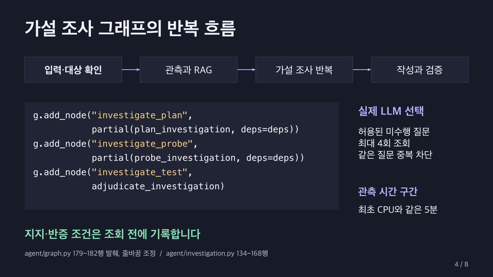

# 운영 진단 에이전트 최종 개선 보고서

최종 구현 확인 2026년 10월 21일 20시 11분 KST  FastAPI · LangGraph · MCP · Vue 3

불필요한 요청은 생성 호출 전에 거절하고, 유효한 장애 질문은 경쟁 가설을 구별할 관측으로 조사하도록 개선했다. 입력 검사에는 LLM을 사용하지 않는다. 최신 입력 거절 5건에서 생성 사용량 0토큰을 확인했고 현재 테스트 99개가 통과했다. 추가 조사 실제 평가의 기능 6/6과 Judge 포함 종합 5/6은 당시 실행 기록으로 구분한다.

## 2 문제 개선 및 신규 구현 사항

### 기존 문제와 개선 판단

| 문제와 해결 과제 | 최종 구현 |
| --- | --- |
| 불필요한 입력도 생성 경로에 진입 | 로컬 규칙으로 무의미·업무 외 입력을 먼저 거절하고 대화 요약에서도 제외한다. |
| CPU 상승과 경고를 원인으로 연결 | 배치·요청량·릴리스 가설을 비교하고 실제 LLM이 다음 관측을 선택한다. |
| 결과를 본 뒤 설명을 조정할 가능성 | 지지·반증 조건을 조회 전에 기록하고 동일한 시간 구간의 관측과 대조한다. |
| 조사 반복과 중복 호출 | 최대 4회, 동일 질문 중복 차단과 성공 근거 재사용으로 호출 상한을 둔다. |
| 일부 실패와 잘못된 답변 | 성공 근거를 보존하고 코드로 수치·출처를 검사한다. 작성 3회 실패 시 사실만 안내한다. |
| 실행 경로 중복과 유지보수 부담 | 비동기 공통 모델 경로로 통합하고 불필요한 스크립트 8개와 코드 400여 줄을 정리했다. |

### 핵심 추가 기능

가설 현황판과 읽기 전용 추가 관측 도구를 구현했다. 프론트는 조사 이유, 사전 조건, 관측 결과, 판단 변경 전후와 종료 이유를 표시한다. 입력을 거절하면 이유와 0토큰을 안내하고 수정할 수 있도록 남긴다.

SQLite에 정상 조사 질문·대상·근거·판정·토큰 사용량을 저장하고 완료 결과와 후속 질문 맥락을 복원한다. 평가 화면은 실제 Judge 점수와 LangSmith 실행 근거, 검토 필요 사례를 구분한다.

RAG·MCP·기록 저장과 부분 실패 대응은 공통 기반이다. 이번 구현의 차별점은 호출 전 차단, 조회 전 반증 조건, 같은 증상에서 추가 관측에 따른 판단 변경을 연결한 데 있다.

## 3 적용 기술 요소

### 생성 호출 전 입력 검증

server.py의 execute가 JSON과 GET·POST SSE의 공통 실행 경로다. 대화와 과거 조사 맥락을 확인한 다음 validate_input으로 진입 여부를 결정한다. 검사를 실패하면 거절 이벤트와 최종 안내를 보내고 return한다. 이후 그래프·MCP·RAG·생성 호출과 대화 저장에는 진입하지 않는다.

코드 1  그래프 실행 전에 입력을 검사하는 공통 경로

```python
admission = validate_input(req.message, known, state["context"], req.targets)
if not admission["passed"]:
    event = {"type": "InputRejected", "code": admission["code"], "message": admission["reason"],
             "tokens": 0, "llm_called": False}
    yield event
    state.update(route="reject", status="rejected", targets=[])
```

server.py 217~222행

같은 함수의 227행 return 뒤에 232행의 graph.astream이 위치한다. 거절 응답은 status=rejected, tokens=0, model_usage=[], llm_called=false를 명시한다. 생성 사용량 0은 검사 자체에 모델이나 임베딩을 호출하지 않는 구조에서 나온다.

유니코드 표현과 보이지 않는 문자를 정규화한 뒤 자음·기호만 있는 입력, 반복 문자와 명백한 업무 외 요청을 검사한다. 시스템 선택만으로 잡담을 허용하지 않는다. 등록·미등록 시스템명은 기존 대상 확인 절차로 보내고, 기존 조사 맥락이 있는 짧은 답변은 허용한다.

코드 2  운영 요청과 맥락이 있는 짧은 답변 허용

```python
targets, unknown = explicit_targets(text, known)
if targets or unknown or INCIDENT.search(text):
    return {"passed": True, "code": "operational", "method": "local-rules"}
if (context.get("pending") or context.get("targets") or selected) and FOLLOWUP_REPLY.fullmatch(text):
    return {"passed": True, "code": "context_reply", "method": "local-rules"}
```

agent/input_validation.py 34~38행

### 토큰 비용을 줄이는 적용 범위

거절 문장은 SQLite 대화·요약에 저장하지 않으므로 다음 생성 요청의 맥락에도 포함되지 않는다. 조사 횟수 제한, 질문 중복 차단과 성공 근거 재사용도 불필요한 호출을 억제한다. 후자의 토큰 감소량과 전체 서비스 비용 절감률은 측정하지 않았다.

규칙 검사는 운영 어휘와 허용 답변을 사용하므로 완전한 의미 분류를 보장하지 않는다. 모호하지만 의미 있는 장애 질문은 기존의 대상 확인으로 연결한다. 거절 기준을 강화할 때는 정상 질문의 오탐도 함께 검사해야 한다.

### LangGraph와 전문 서브그래프

유효한 입력은 등록 대상을 확인한 뒤 지표·로그 서브그래프를 병렬 실행한다. RAG는 관측 내용을 포함해 한 번 검색한다. 이후 계획·관측·판정 노드를 반복하고, 종료하면 보고서 작성과 사실 검증으로 합류한다.



LLM은 허용된 미수행 질문 ID를 선택한다. 배치·요청량·릴리스의 세 가설과 판정 조건은 코드 정책이다. 관측은 최초 CPU 측정으로 끝나는 정확한 5분 구간, 대상·질문·사례·수치 형식을 만족해야 한다. CPU 작업군 기여 비중의 합도 검사한다.

### MCP와 RAG 및 실제 모델 연결

MCP Tool은 작업 중첩, 요청량, 릴리스와 오류율, CPU 기여를 읽는다. Runbook Resource와 표준 절차 Prompt도 사용한다. RAG는 매뉴얼 6종을 다국어 임베딩으로 검색하고 MCP 원문과 대조한다. 실제 계획·작성 모델은 Ollama qwen3.5:2b, 별도 Judge는 qwen3:8b다. OpenAI 제공자도 설정으로 지원하지만 이번 실측에는 사용하지 않았다.

MCP·모델·검색기를 의존성으로 주입한다. 사실·수치·근거 ID·조치 조건은 코드로 검증하고 최대 3회 작성 후 실패하면 관측만 제공한다. LangSmith는 계획·조회·판정·생성·평가를 추적하고 원격 저장을 재조회한다. Judge는 별도 평가이며 매 채팅의 출력 통과 기준은 코드가 담당한다.

## 4 구현 결과

### 최신 입력 검증과 0토큰 확인

입력 검증 실측 시각은 2026년 10월 21일 20시 11분 KST이다. 실제 Ollama가 연결된 프론트 프록시에서 아래 5건을 보냈다. 모두 거절됐고 생성 입력·출력 토큰은 0이었다. LangSmith 원격 실행 기록 5건에서도 LLM과 MCP 호출이 없음을 확인했다.

| 입력 | 전송 방식 | 생성 토큰 | LLM 호출 |
| --- | --- | --- | --- |
| ㅋㅋㅋㅋ | JSON | 0 | 0회 |
| asdf qwer | JSON | 0 | 0회 |
| 오늘 날씨 알려줘 | POST SSE | 0 | 0회 |
| payments-service CPU에 대한 시를 써줘 | POST SSE | 0 | 0회 |
| 😀😀😀 | GET SSE | 0 | 0회 |


단위·API 테스트는 실행 금지 대역으로 거절 입력의 그래프 진입을 막고 토큰 0·모델 사용 내역 없음·MCP 호출 없음·대화 미저장을 검사했다. 기존 대상 확인 질문이 거절 후에도 유지되는지와 시스템명·짧은 후속 답변의 정상 처리를 확인했다. 전체 테스트 99개가 통과했다.

0토큰은 차단한 5건의 생성 사용량이다. 전체 서비스의 비용 절감률이나 유료 API 달러 절감액은 산출하지 않았다. 정상 진단과 별도 Judge 실행에는 토큰을 사용한다.

### 가설 조사 실제 LLM 평가 기록

아래 평가는 2026년 10월 21일 19시 48분 KST의 실제 계획·작성·Judge 실행으로, 입력 검증 도입 전 기록이다. 최초 CPU 91%와 경고 로그를 유지하고 추가 관측만 바꿨다. 기능 6/6, Judge 품질 기준 5/6, 두 기준을 함께 요구하는 종합 평가는 5/6이었다. 코드 정리와 입력 검증 뒤에 이 6건의 Judge 평가를 다시 실행한 결과로 제시하지 않는다.

| 관측 사례 | 조회 | 판단 | Judge 근거 |
| --- | --- | --- | --- |
| batch | 3회 | 중복 배치 작업의 CPU 점유 | 5/5 |
| traffic | 2회 | 요청량 증가에 따른 CPU 점유 | 5/5 |
| release | 4회 | 새 릴리스와 연관된 CPU 점유 | 2/5 |
| conflict | 4회 | 근거 상충 | 5/5 |
| missing | 4회 | 판단 보류 | 5/5 |
| probe-failure | 4회 | 판단 보류 | 5/5 |

release는 관측과 코드 조건을 충족한 답변에 Judge가 2점을 준 오판 사례다. 원래 점수와 종합 미통과를 보존하고 검토 필요로 표시했다. 이 때문에 Judge 점수를 매 채팅의 최종 통과 장치로 사용하지 않는다.

원격 실행 6건과 평가 점수 30개를 저장 후 재조회했다. 반증된 배치를 원인으로 확정하는 문장만 추가한 대조군에서는 별도 원인 주장 평가가 모순을 감지했다. 공개된 기준에 따라 근거 점수에 2점 상한을 적용해 5점에서 2점이 됐으며 원래 전체 점수도 보존했다. 최초 전체 답변 Judge의 미탐지 기록도 남겼다.

### 기존 기능 회귀와 검증 범위

코드 정리 후 기존 12개 고정 응답 회귀 시나리오가 모두 통과했고, 실제 LLM을 사용한 SSE·JSON·SQLite·LangSmith 통합 검증 7개 항목도 통과했다. 고정 응답 비교와 실제 모델 평가를 구분했다. 이후 입력 검증을 포함한 현재 테스트는 99개다.

모든 장애 지표·로그·CPU 기여는 교육용 합성 관측이다. 실제 모델과 도구 연결을 검증했지만 실제 운영 장애의 원인 정확도나 운영 SLA를 증명한 결과는 아니다. 같은 Qwen 계열 생성기와 Judge의 상관 편향도 남는다.

- [같은 CPU · 중복 배치 교차 지지](https://smith.langchain.com/o/470574ed-ef8c-4a69-b528-bc18b8702c54/projects/p/81b28083-02be-4992-a393-c96199b48e09/r/01a15e0f-2418-75bd-a736-4be7186b50e4?poll=true)

- [배치 단서 반증 · 요청량 교차 지지](https://smith.langchain.com/o/470574ed-ef8c-4a69-b528-bc18b8702c54/projects/p/81b28083-02be-4992-a393-c96199b48e09/r/01a15e0f-d94b-72cf-9c2c-50bdce81ba32?poll=true)

- [두 대안 반증 · 릴리스 교차 지지](https://smith.langchain.com/o/470574ed-ef8c-4a69-b528-bc18b8702c54/projects/p/81b28083-02be-4992-a393-c96199b48e09/r/01a15e10-907d-79c1-9dca-770a5098655d?poll=true)

### 주요 기능 화면과 5분 시연


배치 CPU 기여 5%는 반증, 요청 처리 기여 88%와 요청량 3.2배는 교차 지지로 표시된다. 단계별 조사 이유·사전 조건·새 관측·판단 변경을 확인할 수 있다. 완료 결과는 SQLite에서 복원한다. 실행 중 그래프의 체크포인트 재개는 구현하지 않았다.

| 슬라이드와 시간 | 발표와 시연 |
| --- | --- |
| 1  0:00~0:20 | 가설 기반 운영 진단 개선 |
| 2  0:20~1:05 | LLM 호출 전 입력 검증 |
| 3  1:05~1:45 | 입력 거절 5건과 0토큰 확인 |
| 4  1:45~2:30 | 가설 조사 그래프의 반복 흐름 |
| 5  2:30~3:20 | 추가 관측에 따른 가설 수정 |
| 6  3:20~3:55 | 사실 검증과 별도 Judge 평가 |
| 7  3:55~4:30 | 검증 결과와 실행 범위 |
| 8  4:30~5:00 | 한계와 다음 개선 |

PPT는 8장, 총 300초다. 발표자 노트에 멘트와 실제 코드 위치를 넣었다. 입력 거절은 실시간 시연할 수 있고 가설 조사 화면은 저장된 실제 실행임을 설명한다. 발표 중 전체 모델 평가를 다시 실행하지 않는다.

## 5 교훈

### 한계와 트레이드오프

입력을 호출 전에 제한하면 생성 토큰 낭비를 줄일 수 있지만, 로컬 규칙에는 정상 표현의 오탐과 우회 표현의 미탐이 있다. 시스템명과 맥락이 있는 짧은 답변을 보존하는 회귀 검증이 필요하다. 측정한 0토큰 결과와 전체 비용 절감 효과는 구분해야 한다.

추가 조사는 CPU 80% 이상인 인시던트의 세 가설과 네 질문으로 제한했다. 상세 합성 관측은 payments-service에 제공한다. 두 종류 관측의 교차 지지는 인과관계 확정이 아니며, 네 번의 한도는 미확인 가설을 남길 수 있다. 후보 우선순위는 휴리스틱이며 최소 조사 경로를 수학적으로 최적화하지 않았다.

Judge도 관측을 잘못 해석할 수 있었다. 기능 체크와 의미 평가를 분리하고 실패 점수를 보존하는 것이 중요했다. 이번 구현에서는 입력 거절과 원인 판단 보류도 이유와 근거를 보여주는 명시적인 결과로 만들었다.

### 향후 개선 사항

실제 모니터링·프로파일러를 MCP에 연결하고 관측 누락과 수집 시점을 검사할 필요가 있다. 정상·비정상 입력의 사람 라벨로 규칙 오탐률을 측정하고 다른 계열 Judge와 사람 평가를 비교해야 한다. 동일 질문·데이터·모델 설정으로 토큰과 호출 횟수를 비교해 비용 효과도 계측할 계획이다.

### 코드 설명 위치

| 코드 | 시작 행 | 설명 |
| --- | --- | --- |
| server.py | 217 | 입력 검사와 조기 반환 |
| agent/input_validation.py | 19 | 거절 규칙과 짧은 답변 |
| agent/graph.py | 174 | 조사 노드와 조건부 반복 |
| agent/investigation.py | 154 | 허용된 다음 질문 선택 |
| agent/investigation.py | 25 | 조회 전 판정 조건 |
| agent/validation.py | 25 | 사실과 출처 검증 |
| agent/judge.py | 85 | 별도 Judge와 원래 점수 보존 |
| tests/test_api.py | 129 | 그래프 미진입과 0토큰 검사 |

검증 원본은 artifacts/input_validation_verification.json, artifacts/investigation_evaluation.json, artifacts/cleanup_verification.json에 있다. 발표 멘트와 코드 링크는 doc/PRESENTATION_5MIN.md 및 PPT 발표자 노트에서 확인한다.
