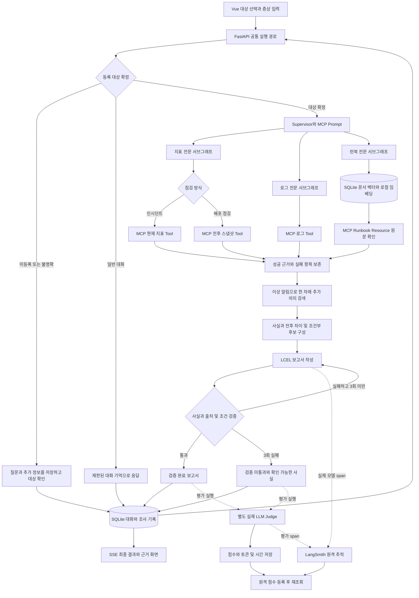
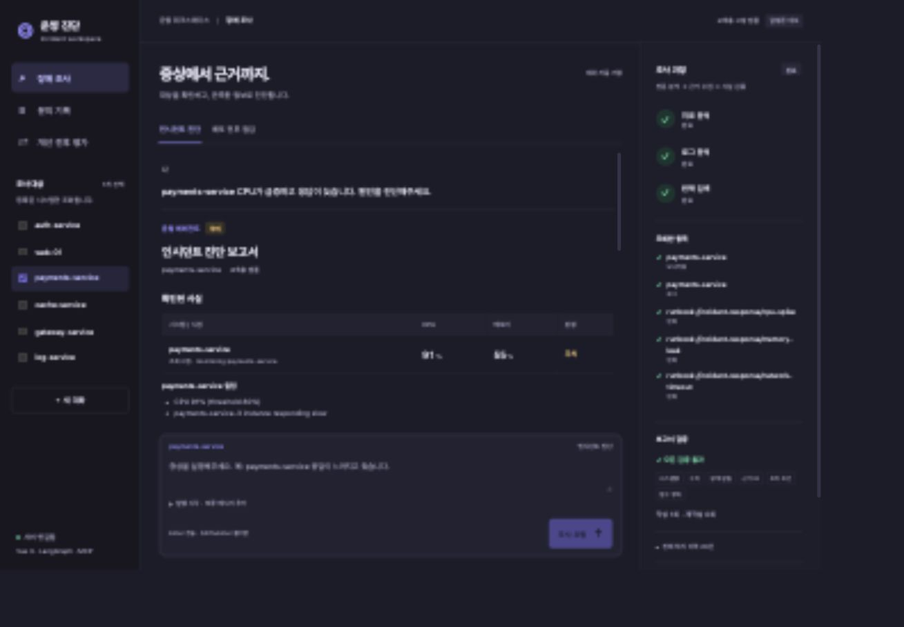
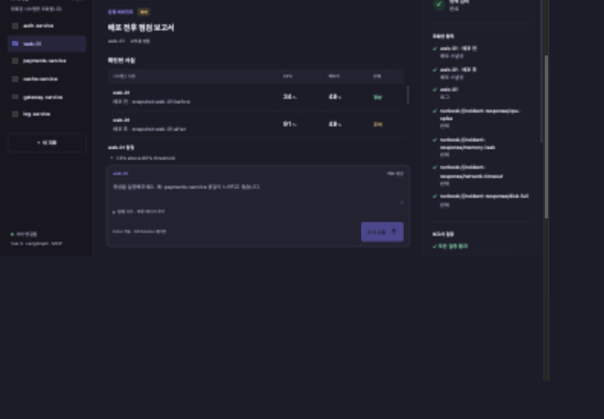
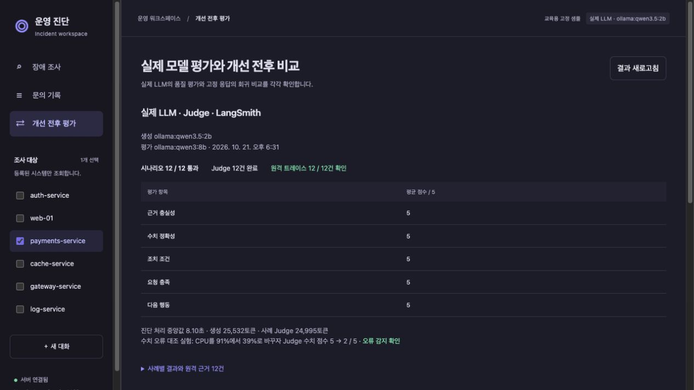
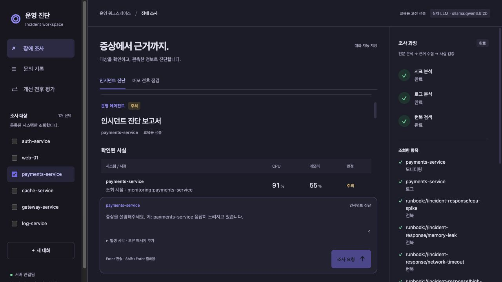

> 추가 조사 도입 전 버전의 기술 기록입니다. 현재 구조와 결과는 [최신 개선 보고서](IMPROVEMENT_REPORT.md)를 참조하세요.

# 운영 인시던트 대응 에이전트 개선 보고서

작성 기준일은 2026년 10월 21일이다. 기존 Python FastAPI, LangGraph, MCP, Vue 3 구조를 유지하면서 **잘못된 대상을 조사하거나 확인되지 않은 내용을 최종 답변으로 제공하는 문제**를 우선 개선했다. 기존/개선 회귀 비교에는 고정 `fake` 응답을 사용했고, 추가 검증에서는 **실제 Ollama 생성 모델 `qwen3.5:2b`와 별도 Judge `qwen3:8b`를 호출해 LangSmith 원격 저장까지 확인했다.** 문서 검색에는 실제 다국어 임베딩 모델을 사용했다. 제공된 지표와 새로 추가한 로그·배포 스냅샷은 교육용 합성 데이터다.

## 2) 문제 개선 및 신규 구현 사항

### 기존 시스템의 문제점과 해결 과제

| 번호 | 확인한 문제 | 개선 내용 | 이 판단을 한 이유 |
|---|---|---|---|
| 1 | 대상이 없으면 `auth-service`로 대체하고, fake 계획에서 `web-01`을 추가 조회했다. | `monitoring.json`을 기준으로 명시된 대상을 확인한다. 미등록·미지정·선택 목록과 질문의 충돌은 되묻고 원래 질문을 보존한다. | 대상 선택 오류는 이후 검색과 답변이 정확해도 다른 시스템에 대한 오진이 된다. 모델 추정보다 대상 확정을 먼저 수행해야 한다. |
| 2 | 키워드 우선순위로 장애 유형 하나와 런북 하나를 선택했다. | 한국어 다국어 임베딩으로 여러 런북을 검색하고, 관측된 알림을 반영해 한 차례 추가 검색한다. | 복합 장애와 우회 표현을 하나의 유형으로 압축하면 대응 문서가 누락된다. 검색 범위를 넓히되 문서 검색 결과를 곧바로 원인 확정으로 사용하지 않는다. |
| 3 | `asyncio.gather`의 예외 하나가 전체 조사를 중단시켰다. | 지표·로그·런북 서브그래프를 병렬로 실행하고, 대상별 실패·시간 초과를 격리한다. 재시도에서는 성공한 근거를 재사용한다. | 한 시스템의 실패 때문에 다른 시스템에서 확인한 사실까지 잃는 것은 정보 손실이다. 성공과 실패를 함께 보존해야 진단 한계를 설명할 수 있다. |
| 4 | 자유 형식 답변에 사실과 추정, 조건부 조치가 섞였다. | 확인된 사실, 로그, 원인 추정, 권장 조치, 참고 런북, 추가 확인 사항을 분리한다. 각 항목에 근거 ID를 연결한다. | 사용자가 직접 확인 가능한 관측값과 추가 검증이 필요한 가설을 구별할 수 있어야 한다. |
| 5 | 검증은 30자 이상·`1)` 포함 여부만 검사하고, 세 번 실패하면 통과시켰다. | 시스템명·CPU·메모리·상태·알림·근거 ID와 허용된 조치 후보를 검사한다. 최대 세 번 실패하면 검증 미통과로 표시하고 확인 가능한 사실만 제공한다. | 길이와 형식은 사실성을 보장하지 않는다. 반복 실패를 성공으로 바꾸면 방어 장치가 무의미해진다. |
| 6 | 프론트가 검증 전 초안을 답변으로 표시하고, 오류 시 별도 안내가 부족했다. | 최종 보고서만 표시한다. 대상 선택, 발생 시각·오류 메시지 입력, 전문 분석 상태, 실패 항목, 검증 결과·재작성 횟수, 원문 출처를 제공한다. | 사용자가 잘못된 초안을 이미 읽은 뒤 최종 답변만 고치는 방식은 혼동을 남긴다. 처리 상태와 결과의 확실성을 화면에서도 구분해야 한다. |
| 7 | 정량적인 개선 전후 근거와 회귀 테스트가 부족했다. | 원본 v2 그래프를 보존하고 같은 고정 입력으로 자동 비교한다. pytest와 실제 HTTP·MCP 통합 검증을 추가한다. | 개선 효과를 시연 한 번이나 주관적 인상으로 설명하지 않고 재현 가능한 자료로 남기기 위해서다. |
| 8 | 공통 조회·판정·검증과 업무 흐름이 한 그래프 파일에 집중됐다. | 대상 확인, 계약 스키마, 검색, 전문 서브그래프, 판정·비교, 프롬프트, 검증, 보고서, 저장소를 분리한다. 인시던트 진단과 배포 비교가 공통 기능을 재사용한다. | 오류가 발생한 계층을 구별하고, 고정 의존성을 주입해 각 기능을 독립적으로 검증하기 위해서다. |

### 새로 구현한 핵심 기능

**대화와 문의 기록 보존.** 브라우저의 대화 UUID를 유지하고 SQLite에 사용자·에이전트 메시지, 확정 대상, 원래 증상, 추가 정보, 점검 결과, 처리 상태와 이벤트를 저장한다. 완료된 대화와 대상 확인 대기 상태는 새로고침과 API 재시작 후 복원된다. 기존 실행 스크립트의 `session.db` 삭제와 포트 전체 프로세스 강제 종료를 제거했다.

**발생 시각과 오류 메시지 수집.** 증상은 질문으로 받고, 추가 입력란에서 발생 시각과 오류 메시지를 수집한다. 누락된 정보는 보고서의 추가 확인 항목에 표시한다. 새 대상을 조사할 때 이전 장애의 발생 시각을 자동으로 붙이지 않는다.

**배포 전후 비교.** 인시던트 흐름은 현재 지표를, 배포 점검 흐름은 같은 대상의 before·after 스냅샷을 조회한다. 정상 유지, CPU 증가, 새 알림, 배포 후 데이터 누락의 네 샘플을 제공한다. 원본 모니터링 파일은 변경하지 않는다.

| 판정 항목 | 현재 적용 기준 |
|---|---|
| CPU | 80% 이상이면 주의 |
| 메모리 | 85% 이상이면 주의 |
| 상태와 알림 | degraded·down 또는 활성 알림이 있으면 주의 |
| 전후 증가 | CPU 15%p 이상 또는 메모리 10%p 이상 증가하면 주의 |
| 새 알림 | 수치가 같아도 새로운 알림이 생기면 주의 |
| 근거 누락 | 필수 조회 실패·전후 스냅샷 누락·정책 버전 오류는 정보 부족 |

예를 들어 CPU 34% → 91%는 **57%p 증가**다. 사용률의 차이를 상대 증가율 57%라고 표현하지 않는다. 판정 기준은 프로젝트의 교육용 정책이며 운영 환경의 SLA를 대신하지 않는다. CPU 경고 기준 80%와 런북의 부하 분산 검토 조건인 ‘90% 초과 및 지속’은 서로 다른 기준이다.

**런북과 조치 정책의 버전 연결.** 조건부 조치 문구를 `data/response_policy.json`으로 분리하고 원문 SHA-256을 저장했다. 원문이 바뀌면 오래된 조치 정책을 자동 적용하지 않고 정책 재검토를 요청한다. CPU가 높다는 단일 관측만으로 ‘지속적인 과부하’나 ‘배포가 원인’이라고 확정하지 않는다. 시스템을 실제 변경하는 도구는 구현하지 않았다.

## 3) 적용 기술 요소

### Multi-Agent와 LangGraph

Supervisor는 확정 대상과 업무 유형을 결정하고 전문 서브그래프를 호출한다. 지표, 로그, 런북은 각각 별도의 `StateGraph`와 전용 상태를 가진다. 지표·로그·런북 수집을 동시에 시작하고 결과를 모은 뒤, 이상 알림이 있으면 알림을 포함한 질의로 런북 검색을 한 번 보강한다. 이후 공통 보고서 구성·검증 단계로 합류한다.

지표의 임계값 판정과 로그 개수 요약은 결정론적 처리이며 전문 노드마다 LLM을 별도로 호출하지 않는다. LLM은 실제 백엔드를 선택한 경우 근거를 보존하면서 허용된 가설·조치 후보를 선택한다. 이 구성은 모델 호출 비용과 비결정성을 줄이지만 자유로운 원인 분석의 범위는 제한한다. 서브그래프는 부모 그래프와 다른 상태를 받아 결과를 매핑하는 방식으로 구성했다. [LangGraph 공식 서브그래프 문서](https://docs.langchain.com/oss/python/langgraph/use-subgraphs)

주요 구현: `agent/graph.py`, `agent/specialists.py`, `agent/deps.py`.

### MCP 표준 인터페이스

| 구분 | 제공 인터페이스 | 실제 사용 방식 |
|---|---|---|
| Tool | `list_systems`, `get_monitoring_status`, `get_recent_logs`, `get_deployment_snapshot` | 등록 목록과 대상별 읽기 전용 지표·로그·전후 스냅샷 제공 |
| Resource | `runbook://incident-response/{incident_type}` | 검색 문서의 원문을 MCP로 다시 읽고 인덱스 본문과 비교 |
| Prompt | `incident_analysis_prompt` | 확정된 대상과 증상으로 공통 절차를 읽어 보고서 작성 입력에 포함 |

기존 다중 MCP 서버 연결을 유지하며 Resource와 Prompt의 제공 서버를 탐색한다. ClientSession의 요청 ID 다중화를 이용해 독립 조회를 동시에 진행한다. 공통 결과 스키마로 시스템명·수치 범위·로그 형식을 확인한다. 미등록 시스템에 0%를 돌려 정상 지표처럼 보이게 하던 동작을 제거했다.

주요 구현: `mcp_server.py`, `agent/mcp_client.py`, `agent/contracts.py`.

### RAG와 벡터 저장소

FastEmbed의 `sentence-transformers/paraphrase-multilingual-MiniLM-L12-v2`를 로컬에서 사용한다. 공식 지원 목록에 있는 다국어 384차원 임베딩 모델이다. [FastEmbed 지원 모델 문서](https://qdrant.github.io/fastembed/examples/Supported_Models/)

작은 런북 여섯 개를 문서 단위로 벡터화해 SQLite에 본문·모델과 원문 지문·벡터를 저장한다. 질의와 관측 알림을 벡터화한 뒤 코사인 유사도로 회당 최대 세 문서를 검색한다. 최초 검색과 추가 검색의 문서는 근거 ID로 중복 제거한다. 문서 단위 분할은 현재 런북이 짧다는 조건에서 선택했다. 긴 문서가 추가되면 섹션 단위 청킹과 재순위화가 필요하다.

모델 준비·검색·원문 조회 실패는 실패 항목으로 반환한다. 키워드 검색으로 몰래 대체하지 않는다. 검색 후보가 넓게 나올 수 있으므로 실제 관측 조건과 맞는 문서만 가설·조치 후보에 연결한다. 작은 코퍼스에서는 별도 벡터 DB 서버보다 설치·실행 부담이 낮은 SQLite 저장과 선형 코사인 비교가 적합하다고 판단했다. 대규모 ANN 벡터 DB를 구축한 것은 아니다.

주요 구현: `agent/retrieval.py`, `data/runbooks`, `data/response_policy.json`.

### 아키텍처와 코드 품질

- `settings.py`: 경로, 타임아웃, 모델, 판정 기준.
- `targets.py`: 등록 대상 확인, 미등록·모호한 요청·선택 충돌 구분, 후속 질문 연결.
- `contracts.py`: 지표·로그·조치 정책 계약.
- `comparison.py`: 공통 정상·주의·정보 부족 판정과 전후 차이 계산.
- `prompts.py`, `validation.py`, `reporting.py`: 역할 프롬프트, 사실 검증, 보고서 구성·표시.
- `session_store.py`: 원자적인 대화·조사 기록과 구조화된 문맥 저장.
- `deps.py`: 모델·MCP·저장소·설정·검색기의 명시적 의존성 주입.
- `tests`: 조회 실패·거짓 수치·잘못된 출처·재작성·재시작·세션 구분·비교 경계값 검증.

실모델은 `httpx.AsyncClient`로 Ollama Chat API를 비동기 호출한다. 모델·호출 제한·컨텍스트 크기는 환경 설정으로 주입한다. 기존 동기 어댑터를 위한 작업 스레드 경로도 유지한다. 연결 실패·빈 출력·출력 토큰 한도 초과는 오류로 처리하고 fake 결과로 자동 대체하지 않는다. 작성 흐름은 **프롬프트 → 모델 어댑터 → 출력 파서**의 LCEL 체인으로 구성했다. 일반 JSON API와 SSE가 같은 실행·저장 경로를 사용한다. SSE는 POST를 기본으로 사용하고 `[DONE]` 종료 신호, 오류 이벤트, 입력 검증과 같은 대화의 요청 직렬화를 적용했다.

### 관측 가능성과 평가

Supervisor, 전문 서브그래프, 검색, 모델 작성, Judge에 LangSmith `traceable`을 연결했다. UI에는 전문 분석의 진행·완료·실패, 대상별 조회 결과, 원문·근거 ID, 검증 시도와 재작성 횟수를 표시한다.

별도 `agent/judge.py`에 근거 충실성, 수치 정확성, 조치 조건, 요청 충족, 다음 행동의 적절성을 각 0~5점으로 평가하는 실제 LLM Judge 인터페이스를 구현했다. 결정론적 사실 검증이 최종 출력의 안전 장치이고, LLM Judge는 품질 평가를 보완하는 선택 실행 기능이다. 두 평가를 같은 것으로 집계하지 않는다. 코드 평가와 LLM 평가의 용도를 구분하는 접근을 따랐다. [LangSmith 평가 유형 문서](https://docs.langchain.com/langsmith/evaluation-types)

실제 실행에서는 생성기 `ollama:qwen3.5:2b`, 평가자 `ollama:qwen3:8b`를 분리했다. 이미 설치된 로컬 모델을 사용해 유료 생성 API 없이 재현할 수 있게 했으며, Judge는 생성기보다 큰 모델로 구성했다. 두 모델은 같은 Qwen 계열이므로 독립성은 완전하지 않다. 실제 API 응답의 입력·출력 토큰과 시간을 기록하며 로컬 추론의 API 요금은 0달러, 하드웨어·전력 비용은 미포함으로 표시한다.

초기 실모델 연결에서는 사실 배열을 빈 배열로 반환하는 출력이 발생했다. 기존 검증기가 이를 차단하는 것을 확인한 뒤 Pydantic에 사실 필드와 필수 항목을 정의하고, Ollama 구조화 출력 스키마에 관측 사실 개수를 전달했다. CPU 수치를 스키마에 정답으로 고정하지 않고 생성 결과를 원본 지표와 독립 대조한다. 이 선택은 모델 형식 오류를 줄이면서 검증기가 수치 오류를 실제로 탐지할 수 있게 하기 위해서다. [Ollama Chat API](https://docs.ollama.com/api/chat)

Judge에는 **사용자에게 전달된 최종 답변과 원본 도구 근거**를 전달한다. 보고서 후보 전체나 선택하지 않은 조치는 평가 근거에 넣지 않는다. 검증 통과 플래그를 맹신하지 않도록 프롬프트를 정하고, 최종 CPU를 91%에서 39%로 바꾸되 통과 플래그를 유지하는 대조 실험을 추가했다. Judge의 높은 점수가 오류 감지 능력을 대신하지 않기 때문이다.

LangSmith는 환경 설정 확인에 그치지 않고, 실행 종료 후 SDK `flush` → 원격 `read_run(load_child_runs=True)` → 필수 전문 노드·LLM 토큰 확인 → 5개 Judge 점수 `create_feedback` → `list_feedback` 재조회까지 수행한다. 0~5점은 원격 feedback에서 0~1로 정규화한다. 대상 확인 흐름은 지표·로그 조회가 없어야 하므로 흐름별로 필수 span을 구분한다. 화면의 원격 확인 건수는 이 재조회 결과를 사용하며, `/health`의 설정 여부와 구별한다. [LangSmith 코드 추적](https://docs.langchain.com/langsmith/annotate-code), [평가 공식 문서](https://docs.langchain.com/langsmith/evaluate-llm-application)

```bash
# 실제 생성 + 별도 실제 Judge + 원격 트레이스/점수 저장과 재조회
.venv/bin/python -m evaluation.live --backend ollama --require-tracing
# 빠르게 CPU 사례만 재검증
.venv/bin/python -m evaluation.live --backend ollama --case cpu --require-tracing
```

기존 `evaluation.run --judge`는 fake 생성물을 실제 Judge로 평가하는 별도 실험이다. 실제 생성 검증은 `evaluation.live`로 수행하고 결과 파일을 분리해 혼동을 방지했다. 이번에는 기존/개선 양쪽의 실제 LLM 성능을 비교하지 않았으므로 ‘실제 모델 Judge 점수가 개선됐다’고 주장하지 않는다.

### 기타 적용 기술

Vue 3는 기존 방식을 유지하고 JS·CSS를 별도 파일로 분리했다. Vue 실행 파일을 프로젝트 안에 고정해 화면 실행 시 외부 CDN 요청이 필요하지 않도록 했다. 한글 IME 조합 중 Enter 전송을 막고, 대화 전환 후 이전 대화로 재시도되는 문제를 방지했다. 기록 선택 시 해당 보고서로 이동하고 배포 모드·샘플을 복원한다. 모바일에서는 탐색과 대상 선택이 위로, 근거 패널이 아래로 재배치된다.

최근 사용자 질문 여섯 개를 발췌한 요약과 최근 메시지 여덟 개, 구조화된 원래 질문·대상·추가 정보를 모델에 전달해 입력 크기를 제한한다. 전체 문의 원본은 SQLite에 별도로 보관한다. 이는 생성형 장기 요약 메모리나 모든 과거 사실을 검색하는 기억 시스템과는 범위가 다르다.

## 4) 구현 결과

### 실제 처리 흐름



실행 중에는 전문 분석·조회·검증 이벤트가 먼저 전송되고 진단 보고서는 최종 결과에서 표시된다. 일부 도구가 실패해도 성공한 근거는 합류 단계에서 유지된다.

### 주요 기능 시연

| 시연 | 입력 또는 조작 | 확인할 결과 |
|---|---|---|
| 대상 확인 | 시스템 없이 ‘로그인 장애를 진단해주세요’ → 새로고침 → `auth-service` 응답 | 최초에는 조회하지 않는다. 원래 로그인 장애 질문을 이어서 조사한다. |
| 미등록 서비스 | `billing-service 장애 진단` | 미등록 안내와 등록된 목록. 다른 서비스를 대신 조회하지 않는다. |
| 다중 대상 | gateway-service와 payments-service 장애 진단 | 두 시스템의 근거와 복수 런북을 표시한다. |
| 수치 오류 차단 | 테스트에서 CPU 39% 초안을 주입 | 세 번 실패해도 통과시키지 않고 CPU 91%의 도구 사실만 제공한다. |
| 부분 실패 | 한 대상의 지표 조회 시간 초과 주입 | 다른 대상의 CPU 91% 유지, 실패 대상·진단 한계 표시, 실패 항목만 재조회. |
| 배포 비교 | web-01 · CPU 증가 샘플 | CPU 34% → 91%, +57%p, 주의. |
| 배포 데이터 누락 | 배포 후 데이터 누락 샘플 | 배포 전 자료 유지, 배포 후 실패 표시, 전체 판정 정보 부족. |
| 기록 복원 | 조사 완료 → API 재시작 → 화면 새로고침 | 같은 대화의 보고서·대상·추가 정보·업무 방식 복원. |

실제 브라우저에서 현재 지표 조회, 배포 전후 비교, API 재시작 후 대화 복원, 모바일 배치와 기록 선택 시 해당 보고서로 이동하는 동작을 확인했다. 의도적 도구 실패와 잘못된 초안은 테스트에서 주입했으며 운영 중 자연 발생한 장애라고 해석하지 않는다.





### 고정 응답 기반 개선 전후 회귀 비교

| 평가 지표 | 기존 v2 | 개선 v2 |
|---|---:|---:|
| 시나리오 통과율 | 0.0% | 100.0% |
| 조사 대상 정확 일치율 | 41.7% | 100.0% |
| 필수 Runbook 검색 재현율 | 62.5% | 100.0% |
| CPU 수치 근거 일치율 | 92.9% | 100.0% |
| 처리 시간 중앙값 (warm) | 711.7 ms | 20.4 ms |
| 실제 생성 LLM / Judge | 사용 안 함 / 사용 안 함 | 사용 안 함 / 미실행 |

단위·회귀·API·검색 테스트 **38개 통과**. 실제 HTTP·MCP·검색·저장 통합 점검 **5개 흐름 통과**. 데모 실행 스크립트의 기동과 소유 프로세스 정리도 확인했다.

평가 대상은 원본 v2 그래프 보존본과 개선 v2다. MCP를 고정 샘플 어댑터로 통제하고, 생성은 fake, 개선 검색은 실제 로컬 다국어 임베딩을 사용한다. 모호한 질문, 미등록 시스템, 복합 장애, 우회 표현, 일부 시간 초과, 거짓 수치, 대상 확인 후 재개와 배포 비교 등 개선 과제를 겨냥한 12개 사례다.

전체 시나리오 통과는 조사 대상의 정확 일치와 해당 사례의 요구를 모두 충족해야 인정했다. 기존 코드의 임의 추가 조회도 불일치로 판단하므로 낮은 통과율은 프로젝트 전체의 일반적인 답변 정확도를 뜻하지 않는다. 신규 배포 기능이 없는 기존 코드도 해당 기능 사례에서는 미통과로 집계했다. 원본의 태스크당 350ms 인위적 지연 제거가 시간 차이에 포함되어 있어 실제 LLM 속도 개선의 증거로 사용할 수 없다.

검색 지표는 기대 런북을 포함했는지를 보는 재현율이며 검색 정밀도를 측정한 수치가 아니다. 수치 일치율은 최종 답변의 CPU 주장만 독립 파싱해 실제 조회값과 비교한 결과다. 메모리·상태·알림은 계약 기반 테스트로 확인하지만 이 CPU 평가 백분율에 합산하지 않았다. 이 표의 fake 실험에서는 모델 토큰과 비용을 측정하지 않았다. 실제 모델의 별도 실험 결과는 다음 절에서 제시한다.

원본 자료와 재현 명령은 다음과 같다.

- `artifacts/baseline`: 수정 전 그래프·서버·화면 보존본.
- `artifacts/evaluation.json`: 지표와 사례별 평가 결과.
- `artifacts/evaluation_details.json`: 양쪽 실행 원본, 호출 대상과 판정 근거.
- `artifacts/smoke.json`: 실제 HTTP → MCP stdio → 로컬 검색 → SQLite 검증 결과.
- `artifacts/environment.json`: 확인에 사용한 주요 라이브러리 버전.
- `tests`: 단위·회귀·API·실제 캐시 모델 검색 테스트.

```bash
.venv/bin/python -m pip install -r requirements-dev.txt
.venv/bin/python -m pytest -q
LANGCHAIN_TRACING_V2=false LANGSMITH_TRACING=false .venv/bin/python -m evaluation.run
.venv/bin/python -m evaluation.smoke
```

### 실제 LLM·Judge·LangSmith 추가 검증 결과

2026년 10월 21일 18:31 KST 실행을 기준으로 실제 생성과 평가를 수행했다. **12/12 시나리오 통과, 실제 Judge 12/12 완료, 원격 트레이스 12/12 확인, 평가 feedback 60/60 재조회 확인**이다. 대상 미지정·미등록 2건은 생성 모델을 호출하지 않고 코드로 확인 질문을 반환하며, 그 응답도 실제 Judge가 평가했다. 실제 진단이 필요한 10건에서 생성 모델을 총 13회 호출했다. 재작성 호출도 토큰에 포함했다.

| 실측 항목 | 결과 |
|---|---:|
| 생성 모델 | `ollama:qwen3.5:2b` |
| 별도 평가 모델 | `ollama:qwen3:8b` |
| 시나리오 요구 충족 | 12 / 12 |
| Judge 완료 | 12 / 12 |
| LangSmith 원격 종료·span·토큰 확인 | 12 / 12 |
| 원격 평가 점수 등록 후 재조회 | 60 / 60 |
| 진단 처리 시간 중앙값, 전체 12건 | 8.10초 |
| 진단이 필요한 10건의 처리 중앙값 | 8.29초 |
| 별도 Judge 처리 중앙값 | 14.92초 |
| 실제 생성 토큰 | 25,532 |
| 12건 Judge 토큰 | 24,995 |
| 오류 대조군 Judge 토큰 | 2,465 |
| 총 토큰, 이 평가 실행에 한함 | 52,992 |
| 로컬 추론 API 요금 | $0, 하드웨어·전력 및 LangSmith 플랜 비용 제외 |

위 처리 시간은 MCP·검색·작성·검증을 포함하되 별도 Judge와 원격 저장 재조회는 제외한다. 인덱스 준비와 임베딩 초기화는 사전에 수행했다. 매 요청에서 큰 Judge 모델과 생성 모델을 번갈아 사용한 로컬 실행의 수치이므로 운영 처리량·SLA나 fake 비교표의 속도 개선율로 해석하지 않는다. 이후 HTTP·브라우저 시연의 토큰도 이 합계에 포함하지 않는다.

| Judge 항목, 최종 사용자 응답 기준 | 평균 |
|---|---:|
| 근거 충실성 | 5 / 5 |
| 수치 정확성 | 5 / 5 |
| 조치 조건 | 5 / 5 |
| 요청 충족 | 5 / 5 |
| 다음 행동 | 5 / 5 |

모든 평균이 5점인 결과는 고정된 정책 후보와 쉬운 합성 사례, Judge의 관대한 채점 영향을 받는다. ‘실제 운영에서 정확도 100%’로 해석할 수 없다. **CPU 91%를 39%로 바꾸고 검증 통과 플래그를 유지한 음성 대조군**에서는 수치 정확성이 **5 → 2점**으로 내려갔다. Judge가 원본 도구값과 최종 수치의 불일치를 감지했음을 확인했다. 다만 같은 대조군의 근거 충실성은 5점을 유지했으므로 채점 항목 간 오류 전파에 둔감한 한계가 보였다. 향후 루브릭 보정과 사람 평가가 필요하다.

실제 모델의 모든 초안이 통과한 것은 아니다. 배포 후 스냅샷 누락 사례는 첫 초안이 허용되지 않은 가설 ID를 선택해 검증에서 거절됐고, **1회 재작성 후 통과**했다. 의도적으로 CPU를 변조한 사례는 실제 생성 3회 모두 검증에서 거절돼 **검증 미통과**로 종료하고 조회값 91%만 제공했다. 이 사례의 시나리오 ‘통과’는 잘못된 답변을 막았다는 의미이며 보고서 자체의 사실 검증 통과와 구별한다. 부분 실패·배포 자료 누락도 성공한 근거를 유지하고 한계를 표시해야 시나리오 통과로 인정했다.

원격 증빙은 연결한 LangSmith 계정의 `capstone-all-total-live` 프로젝트에서 확인할 수 있다. 링크의 실행 트리에는 전문 노드, 실제 모델 토큰, 평가 span과 5개 feedback이 저장돼 있다.

- [CPU 진단과 실제 Judge 트레이스](https://smith.langchain.com/o/470574ed-ef8c-4a69-b528-bc18b8702c54/projects/p/81b28083-02be-4992-a393-c96199b48e09/r/6f9eb5ef-2f43-44f6-a532-35b166e6545b?poll=true)
- [일부 조회 실패와 성공 근거 유지](https://smith.langchain.com/o/470574ed-ef8c-4a69-b528-bc18b8702c54/projects/p/81b28083-02be-4992-a393-c96199b48e09/r/9292a170-ea90-4724-93ec-0686f216f96b?poll=true)
- [실제 생성 3회와 거짓 수치 차단](https://smith.langchain.com/o/470574ed-ef8c-4a69-b528-bc18b8702c54/projects/p/81b28083-02be-4992-a393-c96199b48e09/r/a38c14e1-60f4-4a4f-afc9-3fe8c845d606?poll=true)
- [배포 후 자료 누락과 재작성](https://smith.langchain.com/o/470574ed-ef8c-4a69-b528-bc18b8702c54/projects/p/81b28083-02be-4992-a393-c96199b48e09/r/c94d5871-c9ee-4d8c-85b2-6e98d22302c2?poll=true)
- [실측 요약](../artifacts/live_evaluation.json), [실행별 원본](../artifacts/live/20261021T092504Z/details.json), [원본 경로](../artifacts/live_latest.json).

실제 프론트 프록시 → JSON/SSE API → MCP → 실제 모델 → SQLite 통합 점검도 통과했다. 대상 확인 뒤 원래 CPU 증상을 이어가고, 메시지 4개·조사 기록 2개를 재조회했으며, SSE의 단일 최종 보고서·종료 신호와 배포 CPU +57%p를 확인했다. 일반 진단 요청의 원격 트레이스 2건도 별도로 재조회했다. [실제 API 통합 증빙](../artifacts/live_api_smoke.json)

브라우저에서는 실제 CPU 91% 보고서와 12개 사례 링크를 확인했고 모바일에서 문서의 가로 넘침과 콘솔 오류가 없었다. 평가 화면은 실제 모델 결과를 먼저 보여준다. 사례별 원격 링크, 항목별 Judge 점수, 토큰·시간, 오류 대조 결과를 표시한다. 기존 fake 회귀 비교는 별도 구역에 남겼다.





[모바일 평가 화면 증빙](../artifacts/screenshots/live-evaluation-mobile.png)

### 실행 방법

```bash
bash sh/setup_venv.sh
# Ollama 최초 설치 후 모델 준비
ollama pull qwen3.5:2b
ollama pull qwen3:8b
# .env.example을 참고해 .env에 LangSmith 키와 프로젝트 설정
bash sh/run_live.sh
```

기본 화면은 `http://127.0.0.1:8600`, 실제 모델 API는 `http://127.0.0.1:18100`이다. `.env`의 `LLM_BACKEND=ollama`를 사용한다. 대화 DB와 사용자 키를 보존하고 기존 프로세스를 강제 종료하지 않는다. Ollama가 없으면 로컬 데몬을 시작하며 모델 미설치는 안내하고 중단한다. 필요 시 `AGENT_PORT=18101 FRONTEND_PORT=18601 bash sh/run_live.sh`로 포트를 바꾼다. `run_agent_ollma.sh`도 이 실행기로 연결했다.

첫 의미 검색 준비에는 약 240MB의 로컬 캐시가 필요했다. 생성·Judge 모델의 크기와 컨텍스트에 따라 별도의 메모리가 필요하다. 이번 실행은 이미 설치된 모델과 임베딩 캐시를 사용했다. `run_demo.sh`는 고정 응답 회귀 확인용으로만 유지했다. 실제 OpenAI API는 이번 실험에서 호출하지 않았다.

## 5) 교훈

### 한계와 트레이드오프

**생성의 자유도와 검증 가능성.** 사실을 모델이 자유롭게 다시 쓰게 하기보다 관측 사실을 보존하고 검토된 가설·조치 ID를 선택하게 했다. 수치와 출처를 검증하기 쉬워졌지만 새로운 장애 유형에 대한 풍부한 설명은 정책 후보를 확장해야 한다. 현재 검증은 이 제한된 출력 계약에 대한 검증이며 임의의 자유 문장 전체에 대한 의미적 진실 판별기가 아니다.

**검색 재현율과 정밀도.** 여러 문서를 검색하면 복합 장애의 누락을 줄일 수 있지만 관련성이 낮은 후보도 섞인다. 관측 조건과 조치 정책 검사를 추가해 실행 권고로 연결되는 범위를 좁혔다. 실제 운영 문서로 정밀도·재현율·미응답 기준을 함께 평가해야 한다.

**SQLite의 단순함과 확장성.** 현재 규모에서는 벡터와 대화를 한 파일 계열로 관리해 실행을 단순하게 만들 수 있다. 대규모 코퍼스, 동시 쓰기, 분산 배포에는 전용 벡터 검색과 데이터베이스로의 전환이 필요하다. UUID는 로컬 대화 구분이며 사용자 인증·접근 권한을 대신하지 않는다.

**대화 보존과 실행 재개.** 대화·질문·완료 결과를 보존하는 것과 실행 중인 LangGraph 상태 전체를 재개하는 것은 다르다. 현재는 완료된 결과와 확인 대기 문맥을 복원한다. 프로세스가 조사 도중 종료되면 실행 중 그래프 자체를 이어서 재개하지는 않는다.

**단일 스냅샷과 원인 규명.** CPU 91%는 확인할 수 있어도 과부하의 지속 시간이나 특정 배포와의 인과관계는 이 샘플만으로 확정할 수 없다. 로그도 교육용 일부 사례이며 전체 운영 이력을 대신하지 않는다.

**평가 범위.** 고정 응답 회귀 비교와 실제 생성·Judge 실험을 구분했다. 실제 모델 평가도 12개 합성 사례의 한 번 실행이므로 운영 정확도·SLA를 일반화할 수 없다. 정해진 후보를 선택하는 제한된 생성 계약은 평가를 쉽게 만들며, 같은 Qwen 계열 Judge의 관대함과 상관 편향이 있을 수 있다. 수치 오류 대조군 하나를 감지했다는 결과는 다른 오류의 감지를 보장하지 않는다. 사람 평가·다른 계열 Judge·다양한 반복 실험이 필요하다.

### 향후 추가 개선 사항

1. 실제 모니터링·로그 시스템용 MCP 어댑터와 시계열·배포 변경 이력을 연결한다.
2. 더 큰 평가 데이터에 검색 정밀도, 부적절한 조치 제안율, 모호한 대상 오인율을 추가한다.
3. 이번 실제 생성·Judge 평가를 다양한 입력과 반복 실행으로 확대하고, 다른 계열 평가자와 사람 평가의 일치율을 비교한다.
4. 문서 청킹·재순위화·모델 리비전 고정·정책 개정 승인 절차를 도입한다.
5. 인증·소유권 확인·데이터 보존 정책·민감 로그 마스킹과 접근 감사를 적용한다.
6. LangGraph 체크포인터와 요청 멱등성을 도입해 진행 중 조사 재개와 중복 요청을 관리한다.
7. 장기 과거 문의를 검색하는 기억 계층과 검증된 사실 요약을 추가한다.

### 수행 소감에 활용할 수 있는 관찰

이번 개선에서 가장 큰 변화는 모델의 설명 길이를 늘리는 것이 아니라 **판단 전에 대상을 확정하고, 판단 후에는 근거를 확인하도록 책임을 분리한 것**이다. 모델이 일관되지 않은 출력을 만들 수 있다는 전제에서 코드·데이터 계약·사용자 인터페이스를 함께 설계해야 한다는 점을 확인했다.

또한 세션 저장소만 구현해도 실행 스크립트가 DB를 지우면 대화는 보존되지 않는다. 백엔드 검증이 실패해도 화면이 초안을 먼저 보여주면 사용자는 잘못된 내용을 접하게 된다. 개별 함수의 개선이 실제 사용자 경험으로 이어지려면 시작 스크립트부터 최종 화면까지 한 흐름으로 검증해야 한다.

개인의 수행 소감은 위 관찰을 바탕으로 실제 맡은 역할과 경험에 맞춰 작성하는 것이 적절하다.
