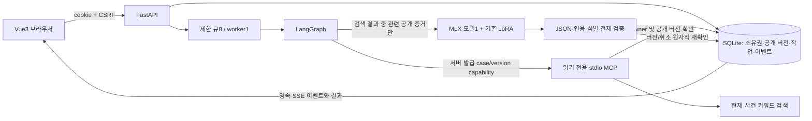

# 구조와 데이터 흐름

로컬 단일 프로세스 FastAPI + Vue3/Vite. 서버는127.0.0.1:8100에 한 worker로 기동한다. 원래 학습/evaluation 디렉터리는 오프라인 도구로 보존하고 서비스 모듈은 recase/에 분리했다.

LangGraph 노드: scope → retrieve → analyze → verify → finalize. 생성은 주장당 최대1회/작업 최대4회, 재검토 루프0, 형식 복구1회, 총180초. 검색 결과가 불충분하면 모델을 호출하지 않고 PARTIAL/INSUFFICIENT로 표시한다. 실제 모델 호출 여부와 토큰은 결과 usage에 기록한다. fixture 모드는 명시적으로 선택할 때만 사용하며 실제 모델 실패의 fallback으로 쓰지 않는다.

## 경계

- 세션은 무작위 HttpOnly/SameSite=Strict cookie. 쓰기는 서버의 CSRF 값과 same-origin 검사. Local demo는 loopback/trusted host로 제한하며 실제 사용자 로그인 서비스와 구분한다.
- 사건/증거/작업/결과/SSE/비교는 동일한 owner 확인. 미공개 증거는 공개 수량만 알려주고 ID/내용을 반환하지 않는다. 공개 API는 서버가 선택한 다음 증거만 공개한다.
- MCP child는 service가 부여한 DB 경로와 단기 HMAC scope만 받는다. 모델이 owner·권한·경로·URL을 선택하지 않는다. get_public_case/read_evidence/search_case_evidence/search_reference_judgments만 노출한다. DB는 읽기 전용으로 연다.
- 참고 판례 검색은 코퍼스가 없어 BLOCKED. 현재 사건 검색 결과와 참고 판례를 혼합하지 않는다. 검색은 bigram/keyword 기준선이며 벡터/Hybrid는 채택하지 않았다.
- `LocalModel`은 오프라인 snapshot/어댑터 호환성을 확인하고56개 LoRA 모듈을 검증한다. 프로세스 모델 lock은 개선된 MLX 평가·서빙·학습 launcher가 공유한다. 모델 단일 생성은 thread lock과 worker1로 제어한다.
- 채택된 결과 캐시는 없다. 매 작업마다 case/version/model/snapshot을 보존한다. 공개 버전 변경 중 작업은 STALE이고 결과를 현재 버전으로 저장하지 않는다. 재시작 시 진행 작업은 SERVER_RESTARTED로 실패 처리하고 기존 결과는 보존한다. 자동 checkpoint resume는 구현하지 않았다.
- 원시 thinking/추론 trace는 서비스에 저장하지 않는다. 모델 내부 role별 다중 에이전트를 꾸미지 않고 단순한 검증 그래프로 구성했다. 추가 복잡성의 효과를 측정할 비교셋은 아직 없다.

## 저장 형식

SQLite schema v1: sessions, cases, evidence, claims, jobs, events, audit. evidence.released_version=NULL은 미공개. jobs.snapshot은 요청 당시 공개 자료만 포함한다. 최종 저장 transaction에서 case version/cancel flag를 확인한다. events.id는 영속 SSE 재접속 cursor이며 결과/이벤트 모두 owner를 재검사한다.

파일 기반 결과는 고유 outputs/runs 하위에만 생성하고 기존 목적지는 거부한다. 프로토콜·모델 revision·tokenizer/config/adapter 해시·생성 조건·dataset hash·sample ID를 manifest에 저장한다. 자세한 계약은 REQUIREMENTS와 JSON Schema를 따른다.

## 개인 로컬 운영과 데이터 통제 후속

개인 접근키 → 로컬 폼 또는 API Basic → HttpOnly/SameSiteStrict 1시간 메모리 인증 세션 → 기존 owner/CSRF/public-version API → MCP → 단일 MLX → 결과의 흐름이다. 접근키는 보호 파일에만 있고 브라우저 저장소/프론트엔드 번들/로그에 넣지 않는다. 데모 owner는 여전히 합성 세션이며 다중 사용자 실명 계정 모델이 아니다.

데이터 경로는 별도다: 격리 반입 → 사람 검수/목적별 권한 해시 ledger → 계열/중복/노출/정답 계약 감사 → 실제 OS 정답 접근 거부 → 고정 train/valid bundle → 최대3개 학습 예산. 한 단계라도 없으면 학습을 실행하지 않는다. 이력 해시 체인은 같은 UID 운영자의 전면 재작성을 막는 OS 경계가 아니다.

삭제는 서비스 중단 잠금 아래 별도 journal을 먼저 fsync하고 DB의 사건·근거·주장·작업·이벤트/관련 세션을 제거한다. 개인 서버 기동과 통제된 새 DB 복구는 journal을 재생한다. 복구 시 모든 bearer 세션을 폐기한다. 과거 백업을 복구해 삭제 사실까지 롤백하면 안 된다. 실제 자료 파생 학습본/인덱스는 아직 연결하지 않았다.
